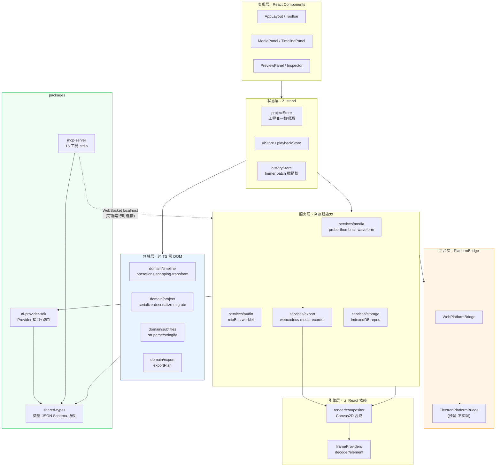
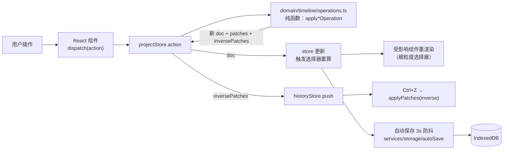
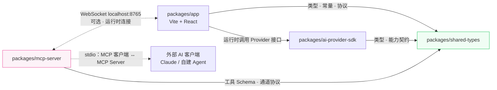
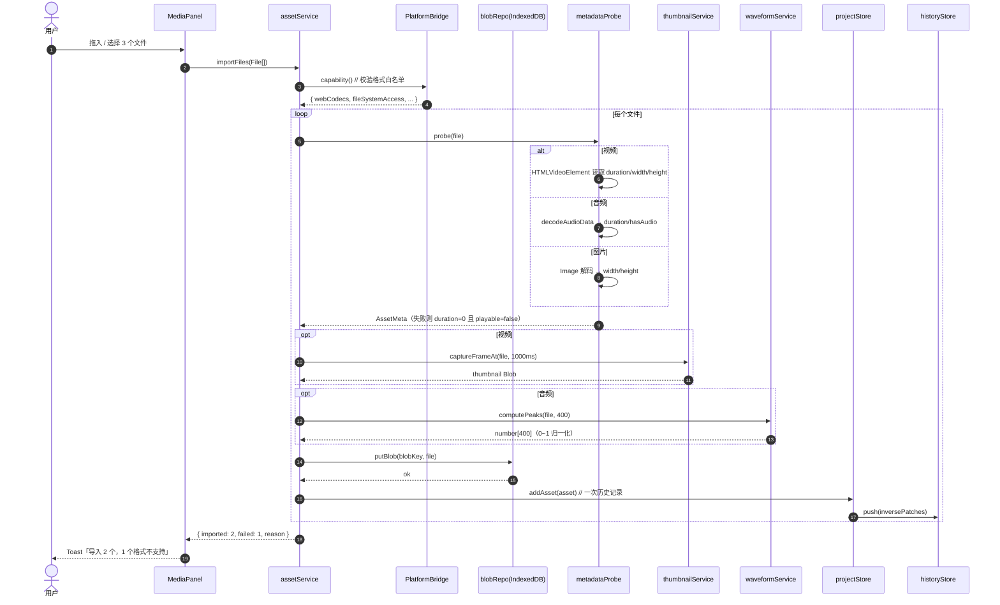
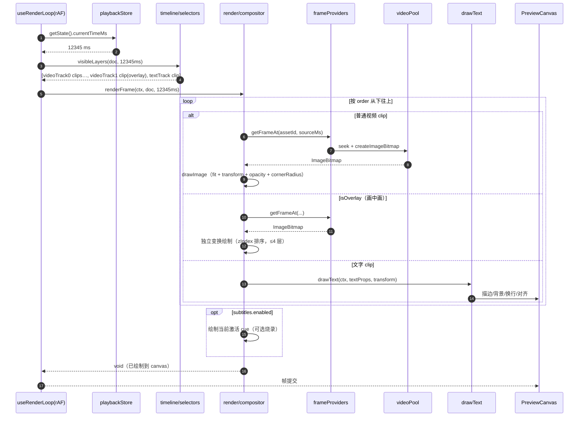
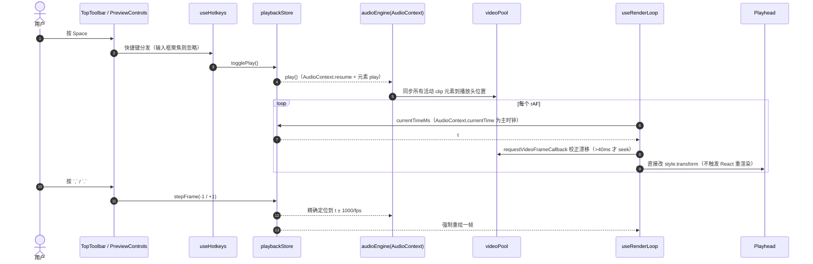
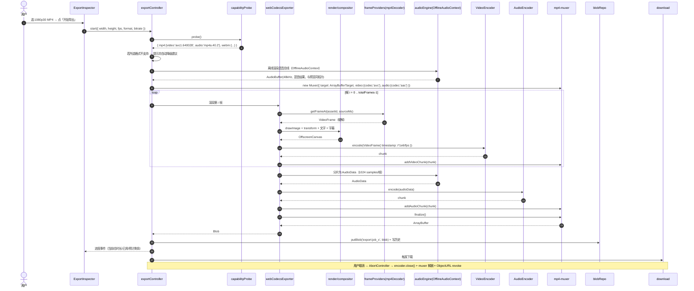
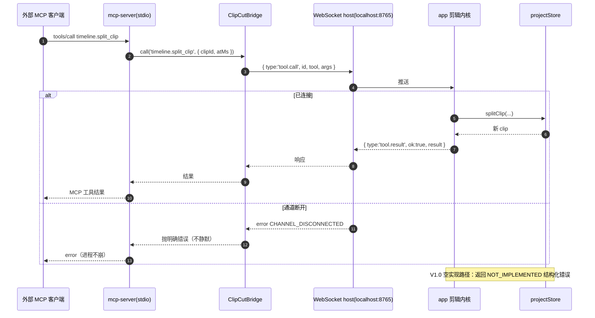

# ClipCut Web · V1.0 系统架构设计

> 项目：`clipcut-web` · 版本：v1.0.0-arch · 日期：2026-10-23
> 作者：高见远（架构师） · 输入：[`docs/PRD.md`](./PRD.md)
> 形态：纯前端（浏览器内运行）· 静态部署 · 零后端 · 开源（GitHub）

---

## 0. 设计总纲

### 0.1 一句话架构

> **一个纯静态的浏览器应用，内部分为「纯领域层（可单测）+ 平台适配层（可替换）+ 渲染/导出引擎（无 UI 依赖）」，通过 WebSocket 本地通道对外暴露 MCP 工具，所有浏览器 API 收敛到 `PlatformBridge` 之后。**

### 0.2 三条硬性架构约束（对应 PRD 验收总纲 §8.6）

| 约束 | 落地手段 | 强制机制 |
|---|---|---|
| **业务层零直接调用 `window.*` 文件/存储 API** | 所有文件/存储/能力探测走 `PlatformBridge` | ESLint `no-restricted-properties` 分层规则 + CI 阻断（白名单仅 `src/platform/**`、`src/services/storage/db.ts`） |
| **AI 能力层零厂商 SDK 依赖** | `ai-provider-sdk` 只定义接口；厂商实现放 `src/providers/*` 且均为空实现 | `pnpm why` 检查 + CI 断言 `packages/ai-provider-sdk` 依赖树中无 `openai`/`@anthropic-ai` 等 |
| **零上传（Network 面板 0 次素材上行）** | 素材字节只走 `Blob → IndexedDB`；唯一出网请求是用户主动配置的素材库/AI Provider | 素材相关模块禁用 `fetch`/`XMLHttpRequest`/`sendBeacon`（lint 规则），素材库与 Provider 请求集中在 `src/services/**` 白名单目录 |

### 0.3 关键不变式（贯穿全代码，必须在 `domain` 层单点保证）

```ts
// 唯一允许写 clip 时间字段的地方：packages/app/src/domain/timeline/operations.ts
durationMs === Math.round((outMs - inMs) / speed)   // 对所有 assetId !== null 的 clip
```

- `meta.durationMs` = `max(所有 clip 的 startMs+durationMs, 所有 cue 的 endMs)`，由 `domain/project/duration.ts` 派生，**不作为数据源存储**，仅缓存。
- 所有时间量一律 `number`（毫秒整数），序列化前 `Math.round`。

---

## 1. 整体架构

### 1.1 分层架构图



**层间铁律**

1. `L2 领域层` 不 import 任何 `domain` 以外的东西，**不碰 DOM / IndexedDB / fetch**，100% 可在 Node 环境 Vitest 里跑。
2. `L3 状态层` 只通过 `L2` 的纯函数改数据，**不直接 mutate**。
3. `L1 服务层` 是唯一允许碰浏览器 API 的层，且必须经 `L0 PlatformBridge`（文件/存储）或 `L2`（内存计算）。
4. `LX 引擎层` 不知道 React 存在，导出与预览复用同一套合成代码。
5. `packages/*` 之间**只允许单向依赖**：`app → shared-types`、`ai-provider-sdk → shared-types`、`mcp-server → shared-types`，`app` **不依赖** `mcp-server`（只共享协议类型）。

### 1.2 运行时数据流（一次编辑的完整路径）



---

## 2. 包结构与依赖图

### 2.1 仓库布局

```
clipcut-web/
├─ package.json                    # pnpm workspace 根
├─ pnpm-workspace.yaml
├─ tsconfig.base.json
├─ eslint.config.js                # 含"业务层禁调 window.*"规则
├─ vitest.workspace.ts
├─ schema/project.schema.json      # 工程 JSON Schema（唯一真源）
├─ fixtures/*.clipcut.json         # 往返一致性测试夹具
├─ docs/
│  ├─ ARCHITECTURE.md  TASKS.md  system_design.md
│  ├─ ai/provider-api.md
│  └─ mcp/channel-protocol.md
└─ packages/
   ├─ shared-types/                # 跨包类型与协议（零运行时依赖）
   ├─ ai-provider-sdk/             # AI Provider 抽象与路由
   ├─ mcp-server/                  # 独立 MCP Server（stdio）
   └─ app/                         # 主应用（Vite + React）
```

### 2.2 packages 依赖方向



**依赖约束（CI 可检）**

- `shared-types`：零依赖，只出 `.d.ts` + 常量。
- `ai-provider-sdk`：只依赖 `shared-types`；**不依赖任何厂商 SDK**。
- `mcp-server`：只依赖 `shared-types` + `@modelcontextprotocol/sdk`；**不依赖 `app`**（保证未来可拆独立仓库）。
- `app`：可依赖 `shared-types` + `ai-provider-sdk`；**不依赖 `mcp-server`**（仅通过 `shared-types/src/mcp/protocol.ts` 共享协议）。

### 2.3 为什么 MCP Server 走 WebSocket 而不是直接 import 剪辑内核

MCP Server 是独立 Node 进程（stdio），剪辑内核跑在浏览器里。浏览器不能监听端口，所以方向必须是 **Node 端做 WebSocket host，浏览器端做 client**。协议见 `docs/mcp/channel-protocol.md`；本期 V1.0 只交付协议文档 + 双端骨架 + 15 个工具的空实现（`not implemented in v1.0`），不崩进程。

---

## 3. 技术选型决策表

| 领域 | 选定方案 | 选型理由 | 备选方案 | 为何不选 |
|---|---|---|---|---|
| 构建工具 | **Vite 5** | 冷启动 <1s、产物纯静态、ESM 原生、与 Vitest 同构 | Webpack 5 / Rspack | 配置繁琐、构建慢；Rspack 生态未稳 |
| UI 框架 | **React 18 + TypeScript 5** | PRD 已按此设计；生态最大、第三方组件与示例多 | Vue 3 / Svelte | 变更成本 & 与 MCP/AI 生态（React 为主）不匹配 |
| 状态管理 | **Zustand 4 + Immer 10（`produceWithPatches`）** | ① 选择器订阅天然细粒度，1080p 时间线 60fps 更新只重渲染受影响 clip；② Immer patch 天然给出**逆操作**，`undo` 只需 `applyPatches(inverse)`，一次实现覆盖全部编辑动作（FR-059）；③ 无 Provider 样板 | Redux Toolkit / Jotai / Valtio / `useReducer` | RTK 的 slice+thunk 样板对本项目是纯负担；Jotai 原子化不擅长"整棵时间线结构化撤销"；`useReducer` 无法做细粒度订阅，拖拽会整树重渲染 |
| 样式方案 | **Tailwind CSS 3 + CSS 变量设计令牌 + Radix UI 无样式基础组件** | 时间线是**高密度像素级布局**（轨道头 sticky、clip 绝对定位、拖拽手柄、吸附参考线），需要完全掌控盒模型与 z-index；Tailwind 原子类让这类布局最省代码；Radix 提供焦点管理/键盘/ARIA（可访问性）而不强加视觉 | MUI 5 / Ant Design 5 / 纯 CSS Modules | MUI/AntD 视觉与体积都过重（AntD ≈ 1MB+ gzip），且其组件样式与"专业剪辑工具"的高密度暗色主题冲突；纯 CSS Modules 缺少设计令牌与响应式约束，重复劳动多 |
| 无样式组件来源 | **@radix-ui/react-dialog / dropdown-menu / context-menu / tooltip / slider** | 只需 5 个原语；可访问性与键盘行为开箱即用，样式完全交给 Tailwind | Headless UI / 自研 | 自研焦点陷阱与键盘导航成本高；Headless UI 功能覆盖不足 |
| 本地存储 | **IndexedDB + `idb` 6** | 唯一能存 500MB+ Blob 的浏览器存储（FR-002）；`idb` 仅 1KB 级、Promise 化、TS 类型友好 | localStorage / sessionStorage / Dexie | localStorage 有 5MB 上限且同步阻塞，**PRD 明确禁止**存素材；Dexie 体积与特性过剩（本项目只需 4 张表） |
| Schema 校验 | **Ajv 8 + `schema/project.schema.json`（单一真源）** | 运行时反序列化校验与 CI 夹具校验复用**同一份** JSON Schema，不会出现两套定义漂移 | Zod / 手写校验 | Zod 需维护第二份 schema（PRD 验收要求"JSON Schema + TS 类型 + 往返一致"三件套已足够） |
| 导出视频编码 | **WebCodecs `VideoEncoder`** | 浏览器内唯一硬加速 H.264/HEVC/VP9/AV1 通路，满足 FR-039 性能门槛 | ffmpeg.wasm / MediaRecorder | ffmpeg.wasm ≈ 25MB+ 且纯软编，1 分钟 1080p 远超 30s 预算；MediaRecorder 仅作兜底 |
| 导出封装 | **mp4-muxer 5** | 轻量（~10KB）、支持 MP4 直出、专为 WebCodecs 设计 | mp4box.js（仅解封装）/ 自研 box | mp4box 只能解不能封；自研 ISOBMFF 封装是巨大风险 |
| 导出取帧 | **WebCodecs `VideoDecoder` + mp4box 解封装（MP4）**，降级 `HTMLVideoElement` seek（其他格式） | 帧精确、无实时约束、硬加速；MP4 是绝对主流格式 | 仅 `HTMLVideoElement` seek | seek 受关键帧间隔限制，1080p30 逐帧 seek 误差大且慢（>100ms/帧），无法满足 ≤30s/分钟 |
| 导出兜底 | **MediaRecorder + `canvas.captureStream()`** | 浏览器原生、零依赖、FR-040 明确要求 | ffmpeg.wasm | 同上，体积与速度不可接受 |
| 音频引擎 | **Web Audio API（`AudioContext` 预览 / `OfflineAudioContext` 导出）+ 自研 WSOLA `AudioWorklet` 变速保音高** | FR-035 要求预览与导出**同一条混音总线** → 用同一套 `AudioGraphBuilder` 分别构建到两种 Context，拓扑与增益计算共用代码；变速保音高在 `OfflineAudioContext` 无原生能力，必须自研 WSOLA | `<audio>` 元素 / Tone.js | 元素无法精确混音与离线渲染；Tone.js 抽象过重且不解决变速 DSP |
| 波形 / 缩略图 | **Canvas 2D + `decodeAudioData` + `createImageBitmap` 自研** | 波形归一化到 400 点、缩略图取第 1s 帧，需求明确且简单，自研无额外依赖 | wavesurfer.js | wavesurfer 面向"波形播放器"交互，集成成本高于收益 |
| 测试 | **Vitest 3（单元）+ `@vitest/coverage-v8` + Playwright（E2E 冒烟）** | Vitest 与 Vite 共享配置、jsdom 环境、`expect` 语义与 Jest 兼容，迁移成本低；领域层纯函数无需浏览器 | Jest + Testing Library / Playwright 全量 | Jest 与 ESM/Vite 集成需额外转译配置；全量 Playwright 过重，V1.0 只跑 3 条冒烟 |
| 包管理 | **pnpm 9 workspaces** | monorepo 硬链接省磁盘、workspace 协议免版本号、`pnpm -r` 统一编排 | npm workspaces / yarn | npm 安装慢、幽灵依赖问题多 |
| 协议/Schema 共享 | **TypeScript 类型 + JSON Schema 双轨**（`shared-types` 出类型，`schema/` 出 JSON Schema） | MCP 工具入参需 JSON Schema、TS 侧需类型；两者同源手写但有 `ajv` 夹具测试兜底一致性 | ts-to-json-schema 自动生成 | 自动生成需要 AST 工具链与额外构建步骤，收益不抵复杂度（V1.0 手工维护 2 处，有 CI 校验） |
| MCP SDK | **@modelcontextprotocol/sdk（官方）** | 生态兼容、可被任意 MCP 客户端识别 | 自研 JSON-RPC | 协议细节多，自研必然不兼容 |
| 通道 | **WebSocket（Node host / 浏览器 client）** | 浏览器不能监听端口，方向被物理约束；WS 双向、支持事件推送（导出进度） | BroadcastChannel / postMessage | BroadcastChannel 仅同源同浏览器标签页；postMessage 需宿主容器（仅 Electron 场景） |
| i18n | **自研轻量字典 + `useTranslation()` Hook**（约 80 行） | FR-058 要求 zh/en 全覆盖文案；自研无依赖、无 Provider 嵌套、避免 `react-i18next` 的 Suspense/重渲染坑；未来 FR-062 接入框架时可整体替换 | i18next + react-i18next | 引入 ~50KB 与额外 React 上下文；FR-062(P2) 才要求"框架接入"，本期自研字典即满足 P0 |
| 主题 | **CSS 变量 + 暗色单主题** | 剪辑工具惯例暗色；`prefers-color-scheme` 预留 | 亮/暗双主题 | V1.0 不做主题切换（FR-058 提到主题，可先只提供暗色 + 变量占位） |

### 3.1 依赖清单（根 `package.json`）

```jsonc
{
  "devDependencies": {
    "@types/node": "^20.11.30",
    "@types/react": "^18.3.3",
    "@types/react-dom": "^18.3.0",
    "@types/ws": "^8.5.10",
    "@vitest/coverage-v8": "^2.1.8",
    "autoprefixer": "^10.4.19",
    "eslint": "^9.17.0",
    "eslint-plugin-react-hooks": "^5.1.0",
    "happy-dom": "^15.11.6",
    "playwright": "^1.49.1",
    "postcss": "^8.4.49",
    "prettier": "^3.4.2",
    "tailwindcss": "^3.4.17",
    "typescript": "^5.7.2",
    "vite": "^5.4.11",
    "vitest": "^2.1.8"
  }
}
```

```jsonc
// packages/app
"dependencies": {
  "@radix-ui/react-context-menu": "^2.2.4",
  "@radix-ui/react-dialog": "^1.1.2",
  "@radix-ui/react-dropdown-menu": "^2.1.2",
  "@radix-ui/react-slider": "^1.2.1",
  "@radix-ui/react-tooltip": "^1.1.4",
  "idb": "^8.0.0",
  "immer": "^10.1.1",
  "mp4-muxer": "^5.1.5",
  "mp4box": "^0.5.2",
  "react": "^18.3.1",
  "react-dom": "^18.3.1",
  "zustand": "^5.0.2"
}
// packages/mcp-server
"dependencies": { "@modelcontextprotocol/sdk": "^1.6.0", "ws": "^8.18.0" }
```

---

## 4. 完整文件清单

> 路径均相对仓库根。职责一句话。**粗体**为 P0 必做，`(P1)`/`(P2)` 为可延后。
> 合计约 **237** 个文件（含测试与文档）。

### 4.1 仓库根（28）

| 路径 | 职责 |
|---|---|
| `package.json` | pnpm workspace 根，聚合 `dev/build/test/lint/typecheck` 脚本与统一 devDependencies |
| `pnpm-workspace.yaml` | 声明 `packages/*` 为工作区包 |
| `tsconfig.base.json` | 共享 TS 编译选项：`strict`、`moduleResolution: bundler`、`exactOptionalPropertyTypes` |
| `tsconfig.json` | 根方案引用（solution-style），`references` 四个包 |
| `.npmrc` | `link-workspace-packages=true`、`strict-peer-dependencies=false` |
| `.editorconfig` | 统一缩进 2 空格、LF、UTF-8 |
| `.gitignore` | 忽略 `node_modules/dist/.vite/coverage/test-results` |
| `.prettierrc.json` | 无分号、单引号、尾逗号、printWidth 100 |
| `eslint.config.js` | Flat Config；**核心：分层 `no-restricted-properties` 规则**（禁 `window.showOpenFilePicker`/`localStorage`/`indexedDB`/`fetch` 等） |
| `vitest.workspace.ts` | 定义 `app`（happy-dom）与 `shared-types`（node）两个测试工程 |
| `README.md` | 项目介绍、快速开始、架构图、许可、贡献指引入口 |
| `LICENSE` | MIT 许可证（开源默认） |
| `.github/workflows/ci.yml` | CI：`pnpm i → lint → typecheck → test → build → schema 校验 → 零上传静态检查` |
| `schema/project.schema.json` | **工程 JSON Schema（唯一真源，draft 2020-12）**，含 `additionalProperties: true` 以支持未知字段 |
| `fixtures/minimal.clipcut.json` | 最小工程夹具（1 视频轨 1 clip），往返一致性测试用 |
| `fixtures/full.clipcut.json` | 完整工程夹具（多轨 + PIP + 文字 + 字幕 + AI 配置） |
| `fixtures/legacy-0.9.clipcut.json` | 低版本 schema 夹具，验证兼容层加载不抛异常 |
| `docs/ARCHITECTURE.md` | 本文档 |
| `docs/TASKS.md` | 任务分解清单（18 个任务） |
| `docs/system_design.md` | 系统设计索引页（指向 ARCHITECTURE / TASKS / 图） |
| `docs/ai/provider-api.md` | 如何实现一个新 Provider（最小示例代码 + 能力清单） |
| `docs/mcp/channel-protocol.md` | 通道协议：消息类型、握手、事件推送、错误码 |
| `docs/class-diagram.mermaid` | 核心类型类图（Mermaid 源） |
| `docs/diagrams/seq-1-asset-import.mermaid` | 时序图 1/5：素材导入 |
| `docs/diagrams/seq-2-timeline-render.mermaid` | 时序图 2/5：时间线渲染（合成一帧） |
| `docs/diagrams/seq-3-playback.mermaid` | 时序图 3/5：播放 |
| `docs/diagrams/seq-4-export.mermaid` | 时序图 4/5：导出（WebCodecs 主路径） |
| `docs/diagrams/seq-5-mcp-tool-call.mermaid` | 时序图 5/5：MCP 工具调用（骨架） |

### 4.2 `packages/shared-types`（10）

| 路径 | 职责 |
|---|---|
| `package.json` | 包元信息，`exports` 指向 `dist/index.js` + `types` |
| `tsconfig.json` | 继承 base，产出 ESM + `.d.ts` |
| `README.md` | 说明"本包只含类型与协议，零运行时依赖" |
| `src/index.ts` | 统一导出全部公共类型 |
| `src/project.ts` | **`ProjectDoc` / `Track` / `Clip` / `Asset` / `SubtitleDoc` / `ProjectSettings` 等工程模型类型** |
| `src/ai-capabilities.ts` | `AICapability` 七能力枚举、各能力的 `AIInputMap` / `AIOutputMap`、进度与错误类型 |
| `src/mcp/tools.ts` | **15 个 MCP 工具的入参/出参 TS 类型 + JSON Schema 常量** |
| `src/mcp/protocol.ts` | MCP↔剪辑内核 WebSocket 通道消息类型（`hello` / `tool.call` / `tool.result` / `event`）与错误码枚举 |
| `src/common.ts` | 通用类型：`Result<T>`、`Disposable`、`DeepReadonly`、时间常量 |
| `src/time.ts` | 时间工具：`msToFrames`、`framesToMs`、`formatTimecode(时:分:秒:帧)`、`parseTimecode` |

### 4.3 `packages/ai-provider-sdk`（13）

| 路径 | 职责 |
|---|---|
| `package.json` | 包元信息；依赖仅 `shared-types`；导出 `AIProvider` 类型 |
| `tsconfig.json` | 继承 base，ESM 输出 |
| `README.md` | SDK 定位与"零厂商依赖"声明 |
| `src/index.ts` | 公共导出 |
| `src/provider.ts` | **`AIProvider` 接口定义**（`id/name/kind/capabilities/isConfigured/run/dispose`） |
| `src/registry.ts` | `ProviderRegistry`：注册/注销/按能力查询 Provider |
| `src/router.ts` | **`ProviderRouter`**：按能力路由 + 多 Provider fallback 链；未配置抛 `ProviderNotConfiguredError` |
| `src/errors.ts` | `ProviderError` / `ProviderNotConfiguredError` / `ProviderNotImplementedError` / `ProviderTimeoutError` |
| `src/config.ts` | `ProviderConfig` 类型 + `maskApiKey()` 掩码工具（`sk-****abcd`） |
| `src/providers/localHttp.ts` | `LocalHttpProvider` 空实现（Ollama / Whisper.cpp / ComfyUI 协议注释） |
| `src/providers/cloudApi.ts` | `CloudApiProvider` 空实现（OpenAI 兼容协议注释） |
| `src/providers/onnxWeb.ts` | `OnnxWebProvider` 空实现（WebGPU / WASM 降级链） |
| `src/providers/index.ts` | 三个骨架 Provider 的统一导出与默认注册 |

### 4.4 `packages/mcp-server`（15）

| 路径 | 职责 |
|---|---|
| `package.json` | Node 包；`bin: clipcut-mcp-server`；依赖 `shared-types` + MCP SDK + `ws` |
| `tsconfig.json` | Node ESM 输出（`module: NodeNext`） |
| `README.md` | 启动方式（`npx clipcut-mcp-server`）、配置示例、协议说明链接 |
| `src/index.ts` | **stdio 入口**：创建 MCP Server、注册工具、连接剪辑内核 |
| `src/server.ts` | `createMcpServer(deps)`：MCP Server 工厂（便于测试） |
| `src/bridge/clipcutBridge.ts` | `ClipCutBridge`：把 15 个工具调用转发到 WebSocket 通道，映射错误码 |
| `src/bridge/errors.ts` | 通道错误 → MCP 错误码映射（`NOT_IMPLEMENTED` / `CHANNEL_DISCONNECTED` / `INVALID_ARGS` / `TIMEOUT`） |
| `src/channel/wsServer.ts` | WebSocket **host**（Node 侧），握手 + 配对 token 校验 |
| `src/channel/codec.ts` | 通道消息编解码与超时/重试封装 |
| `src/tools/index.ts` | 工具注册表：把 15 个工具挂到 MCP Server |
| `src/tools/projectTools.ts` | `project.get_info` / `project.list_assets` 工具定义与空 handler |
| `src/tools/timelineTools.ts` | `timeline.*` 共 8 个工具定义与空 handler |
| `src/tools/textTools.ts` | `text.create_overlay` 工具定义与空 handler |
| `src/tools/subtitleTools.ts` | `subtitle.import_srt` 工具定义与空 handler |
| `src/tools/exportTools.ts` | `export.start` / `export.get_status` 工具定义与空 handler |

### 4.5 `packages/app` — 入口与样式（14）

| 路径 | 职责 |
|---|---|
| `index.html` | Vite 入口 HTML，`<div id="root">` + 字体预连接 |
| `vite.config.ts` | Vite 配置：`react` 插件、路径别名 `@/` → `src/`、手动 chunk 拆分（vendor/editor） |
| `tsconfig.json` | 应用 TS 配置（继承 base，`jsx: react-jsx`） |
| `tsconfig.node.json` | `vite.config.ts` 的 Node 侧 TS 配置 |
| `vitest.config.ts` | 单元测试配置：`happy-dom` 环境、覆盖率阈值（domain 行覆盖 ≥ 80%） |
| `tailwind.config.js` | Tailwind 配置：内容扫描路径、扩展色板（映射到 CSS 变量）、暗色主题预设 |
| `postcss.config.js` | PostCSS 配置：接入 Tailwind + Autoprefixer |
| `public/favicon.svg` | 站点图标 |
| `public/manifest.webmanifest` | PWA manifest（可安装） |
| `.env.example` | 环境变量示例（素材库 API Key 等，全部可为空） |
| `src/main.tsx` | React 挂载入口，初始化 i18n 与主题变量 |
| `src/App.tsx` | 根组件：路由（工程列表 ↔ 编辑器工作区）、全局快捷键、全局对话框宿主 |
| `src/styles.css` | Tailwind 指令 + 全局基础样式 + 滚动条样式 |
| `src/vite-env.d.ts` | Vite 环境类型声明（`import.meta.env`） |

### 4.6 `packages/app/src/platform` — 平台抽象层（6）

| 路径 | 职责 |
|---|---|
| `PlatformBridge.ts` | **平台桥接口定义**：`readFile/saveFile/listFiles/storage/getMediaDuration/capability` + `PlatformCapabilities` 类型 |
| `WebPlatformBridge.ts` | **Web 实现**：File System Access API 优先，降级 `<input type=file>` / `showDirectoryPicker` 降级 Blob 下载 |
| `capabilities.ts` | 运行时能力探测：WebCodecs 编解码支持矩阵、MediaRecorder、File System Access、WebGPU、IndexedDB |
| `fileTypes.ts` | 支持的 MIME / 扩展名白名单与分类（video/audio/image），FR-006 的唯一来源 |
| `errors.ts` | `PlatformError` / `UnsupportedOperationError` / `PermissionDeniedError` |
| `index.ts` | 导出接口与 `getPlatformBridge()` 单例工厂 |

### 4.7 `packages/app/src/domain` — 纯领域层（18）

| 路径 | 职责 |
|---|---|
| `project/serialize.ts` | **`serialize(doc)`**：工程 → 规范化 JSON（`Math.round` 时间、剥离派生字段、保留未知字段） |
| `project/deserialize.ts` | **`deserialize(json)`**：JSON → 工程，含 Ajv 校验、`schemaVersion` 分派、未知字段保留 |
| `project/migrate.ts` | **版本兼容层**：`0.9.x → 1.0.0` 等迁移函数注册表；高版本拒绝并抛明确错误 |
| `project/duration.ts` | `computeProjectDuration(doc)`：派生 `meta.durationMs` |
| `project/factory.ts` | `createEmptyProject(name)` / `createDefaultTracks()`：新建工程默认 2 视频 + 2 音频 + 1 文字轨 |
| `project/validation.ts` | Ajv 实例封装 + `validateProjectDoc()` + 自定义错误信息格式化 |
| `project/index.ts` | 领域层工程子模块导出 |
| `timeline/operations.ts` | **唯一写入口**：`addClip/moveClip/trimClip/splitClip/deleteClip/duplicateClip/setSpeed/setGain/applyTransform` 等纯函数（返回新 doc + patches） |
| `timeline/invariants.ts` | 不变式校验：`assertClipInvariants`、`fixClipDuration`（变速后重算 `durationMs`） |
| `timeline/snapping.ts` | 吸附计算：候选点收集（播放头/其他 clip 首尾/整秒）→ 8px 阈值命中 |
| `timeline/selectors.ts` | 派生查询：`clipsAtTime(doc, ms)`、`visibleTracks(doc)`、`orderedTracksByOrder`、`clipEndMs` |
| `timeline/transform.ts` | 画布比例变更时 `transform.x/y` 与 `fontSize` 的等比换算（PRD §4.1） |
| `timeline/index.ts` | 领域层时间线子模块导出 |
| `subtitles/srt.ts` | **SRT 解析与序列化**：`,`/`.` 毫秒分隔符兼容、逐行容错、往返一致 |
| `subtitles/index.ts` | 字幕子模块导出 |
| `export/exportPlan.ts` | 导出计划：帧数、码率、时长校验、非法组合（4K@60）检测与降级建议 |
| `export/index.ts` | 导出子模块导出 |
| `index.ts` | 领域层总出口（**只允许本目录内部 import 外部库，且不得 import DOM/浏览器 API**） |

### 4.8 `packages/app/src/state` — 状态层（8）

| 路径 | 职责 |
|---|---|
| `projectStore.ts` | **工程唯一数据源**：Zustand store 持有 `doc`；所有变更经 `applyOperation` |
| `historyStore.ts` | 撤销/重做栈：保存 Immer `inversePatches`，上限 100 步，保存工程后清空 |
| `uiStore.ts` | 纯 UI 态：选中 clip/轨道、缩放 `pxPerSecond`、滚动位置、面板宽度、吸附开关、对话框开关 |
| `playbackStore.ts` | 播放态：`currentTimeMs`、`isPlaying`、`playbackRate`；高频更新走 `subscribe` 轻量通道 |
| `selectors.ts` | 跨 store 的组合选择器（memoized），供组件用 `useStore(selector, shallow)` |
| `actions.ts` | **所有编辑动作的集中定义**（每条 = 一次可撤销操作）：`splitSelectedClip` / `trimClip` / `setClipSpeed` … |
| `storeMiddleware.ts` | 自定义中间件：自动保存调度（3s 防抖）、`beforeunload` 强制落盘、脏标记 |
| `index.ts` | 状态层导出 |

### 4.9 `packages/app/src/services` — 浏览器服务层（27）

| 路径 | 职责 |
|---|---|
| `storage/db.ts` | **IndexedDB 打开与建表**（`projects` / `blobs` / `exports` / `settings` 四表 + 索引） |
| `storage/projectRepo.ts` | 工程 CRUD：`listProjects`（按 `updatedAt` 倒序）/ `saveProject` / `loadProject` / `deleteProject` |
| `storage/blobRepo.ts` | Blob 存取：`putBlob(key, blob)` / `getBlob(key)` / `deleteBlob` / `getMissingBlobKeys(keys)`（relink 用） |
| `storage/exportHistoryRepo.ts` | 导出历史持久化（最近 10 条，含时间/时长/大小/格式） |
| `storage/settingsRepo.ts` | 全局设置持久化（语言、主题、Provider 配置、素材库 API Key） |
| `storage/autoSave.ts` | 自动保存调度器：编辑后 3s 防抖落盘、`beforeunload` 同步兜底 |
| `storage/index.ts` | 存储层导出 |
| `media/assetService.ts` | **素材导入编排**：落盘 Blob → 探测元数据 → 生成缩略图/波形 → 写入 `assets` |
| `media/metadataProbe.ts` | 元数据解析：视频用 `HTMLVideoElement`、音频用 `decodeAudioData`、图片用 `Image`；失败置 `duration=0` 且不阻塞 |
| `media/thumbnailService.ts` | 缩略图生成：视频取第 1s 帧 → `createImageBitmap` → PNG Blob；结果写回 `thumbnailBlobKey` |
| `media/waveformService.ts` | 波形峰值：解码 PCM → 归一化 0~1 → 400 采样点数组 |
| `media/videoPool.ts` | **离屏 `<video>` 元素池**：按 asset 复用元素、预取/seek 管理、`requestVideoFrameCallback` 帧同步 |
| `media/audioEngine.ts` | 预览音频：AudioContext 生命周期、元素→混音总线、播放/暂停/Seek 对齐 |
| `media/audioGraph.ts` | **混音拓扑共享层**：`buildAudioGraph(context, doc, timeMs)` 构建到任意 `BaseAudioContext`，预览与导出共用同一套增益/包络计算 |
| `media/frameProviders/types.ts` | `FrameProvider` 接口：`getFrameAt(assetId, sourceMs) → ImageBitmap`，含能力声明 |
| `media/frameProviders/elementProvider.ts` | 降级取帧：`HTMLVideoElement` seek + `createImageBitmap`（WebM/未知容器/无 WebCodecs） |
| `media/frameProviders/mp4DecoderProvider.ts` | 主路径取帧：mp4box 解封装 + `VideoDecoder` 硬解 + GOP 帧缓存 |
| `media/frameProviders/index.ts` | 按容器/MIME 与能力自动选择 provider 的工厂 |
| `media/worklets/pitchPreserveStretchProcessor.ts` | **WSOLA 变速保音高 AudioWorklet**（导出离线渲染用） |
| `media/index.ts` | 媒体服务导出 |
| `export/exportController.ts` | 导出编排：能力探测 → 选路径 → 逐帧/实时 → 进度事件 → 取消 → 落库 → 触发下载 |
| `export/capabilityProbe.ts` | 探测 `VideoEncoder.isConfigSupported` / `AudioEncoder` / `MediaRecorder`，产出**编码器能力矩阵** |
| `export/webCodecsExporter.ts` | **主路径导出器**：逐帧渲染 → `VideoEncoder` + `AudioEncoder` → `mp4-muxer` → Blob |
| `export/mediaRecorderExporter.ts` | **兜底导出器**：`canvas.captureStream()` + `AudioContext.createMediaStreamDestination()` → MediaRecorder(WebM) |
| `export/audioExporter.ts` | 独立音频导出（WAV 兜底 / MP3 视 `AudioEncoder` 支持） |
| `export/download.ts` | 触发浏览器下载 + 释放 ObjectURL（避免内存泄漏） |
| `export/index.ts` | 导出服务导出 |

### 4.10 `packages/app/src/render` — 合成引擎（6）

| 路径 | 职责 |
|---|---|
| `compositor.ts` | **核心合成器**：`renderFrame(ctx, doc, timeMs)` — 按 `order` 从下往上合成视频轨、叠加 `isOverlay` 画面、绘制文字轨、烧录字幕 |
| `drawImage.ts` | 单图层绘制：`fit` 模式（contain/cover/fill）、`transform`（x/y/scale/rotation/opacity/cornerRadius）应用 |
| `drawText.ts` | Canvas 文本绘制：多行换行、描边、背景、行高、字间距、对齐、垂直对齐 |
| `drawTransform.ts` | `transform` → Canvas 矩阵计算（供 PIP 与文字共用，FR-030） |
| `frameCache.ts` | 帧/缩略图 LRU 缓存（`assetId+时间桶` → ImageBitmap），带内存上限与释放 |
| `index.ts` | 渲染层导出 |

### 4.11 `packages/app/src/hooks`（6）

| 路径 | 职责 |
|---|---|
| `useRenderLoop.ts` | rAF 渲染循环：驱动预览合成，播放态高频更新走 ref 不触发 React 重渲染 |
| `useHotkeys.ts` | 全局快捷键绑定（空格/`,`/`.`/`J K L`/`S`/`Delete`/`Ctrl+Z` 等），输入框聚焦时自动禁用 |
| `useFileDrop.ts` | 全窗口拖拽导入（`dragover/drop`），含拖拽遮罩态 |
| `useVirtualizedRows.ts` | 时间线视口虚拟化：按 `pxPerSecond` 与滚动位置计算可见时间窗，只渲染窗口内 clip |
| `useClipDrag.ts` | **clip 拖拽**：指针事件 → 实时 transform（直接改 DOM style）→ 吸附计算 → 抬手时提交 store（单次历史记录） |
| `useClipResize.ts` | **clip 裁剪**：左右边缘拖拽 → 实时宽度/预览 → 抬手提交，越界钳制与最小 100ms 校验 |

### 4.12 `packages/app/src/components` — 表现层（60）

**布局（5）**

| 路径 | 职责 |
|---|---|
| `layout/AppLayout.tsx` | 三栏 + 底部时间线的主布局骨架，可拖拽调整侧栏宽度 |
| `layout/TopToolbar.tsx` | 顶部工具栏：工程操作、传输控制、时间码显示、设置入口 |
| `layout/StatusBar.tsx` | 底部状态条：能力告警、当前选中、缩放比、吸附开关 |
| `layout/PanelResizer.tsx` | 面板拖拽分隔条（侧栏/属性面板宽度） |
| `layout/WorkspaceTabs.tsx` | 编辑器与设置面板之间的 Tab 容器 |

**素材面板（6）**

| 路径 | 职责 |
|---|---|
| `media/MediaPanel.tsx` | 素材库主面板：本地/在线库/连接器 Tab、导入按钮、搜索与筛选 |
| `media/MediaGrid.tsx` | 网格视图（虚拟化 + IntersectionObserver 懒加载缩略图） |
| `media/MediaCard.tsx` | 单个素材卡片：缩略图/名称/类型/时长/分辨率，拖拽源（HTML5 DnD） |
| `media/MediaToolbar.tsx` | 搜索框（200ms 防抖）、类型筛选、排序、导入按钮 |
| `media/MediaDropZone.tsx` | 拖拽导入遮罩与提示 |
| `media/OnlineLibrary.tsx` | (P1) Pixabay / Freesound 列表卡片、许可信息、下载缓存为本地 Blob |

**时间线（12）**

| 路径 | 职责 |
|---|---|
| `timeline/TimelinePanel.tsx` | 时间线容器：轨道堆叠、标尺、播放头、滚动与缩放、快捷键作用域 |
| `timeline/TimelineToolbar.tsx` | 分割/删除/复制/吸附开关/缩放控件 |
| `timeline/TimelineRuler.tsx` | 时间标尺：按缩放自适应刻度（ms/s/min），点击跳转、拖拽播放头 |
| `timeline/TrackHeader.tsx` | 轨道头：名称/静音/隐藏/锁定/高度，粘性固定不随横向滚动 |
| `timeline/TrackRow.tsx` | 单轨道行：承载 clip，绝对定位，接收虚拟化窗口 |
| `timeline/ClipView.tsx` | 单个 clip 视图：缩略图条/波形、边框、选中态、PIP 特殊描边、拖拽与裁剪手柄 |
| `timeline/ClipTrimHandle.tsx` | 左/右裁剪手柄（8px 命中区，hover 显示精确时间码） |
| `timeline/Playhead.tsx` | 播放头：拖拽定位、随播放实时移动（ref 直写 style） |
| `timeline/SnapIndicator.tsx` | 吸附参考线高亮层 |
| `timeline/TimelineContextMenu.tsx` | clip 右键菜单（分割/裁剪/变速/静音/删除/设为画中画） |
| `timeline/WaveformCanvas.tsx` | clip 内波形绘制（按缩放级别重采样，用缓存避免卡顿） |
| `timeline/index.ts` | 时间线组件导出 |

**预览（4）**

| 路径 | 职责 |
|---|---|
| `preview/PreviewPanel.tsx` | 预览面板容器：画布 + 传输控制 + 画布设置栏 |
| `preview/PreviewCanvas.tsx` | 预览 `<canvas>`，承载合成器输出，支持点击选中画面上的 clip |
| `preview/PreviewControls.tsx` | 播放/暂停/上一帧/下一帧/首/尾/J K L 控件 |
| `preview/CanvasSettingsBar.tsx` | 画布比例预设（16:9 / 9:16 / 1:1 / 4:5 / 原始）与缩放模式（适配/填满/原始） |

**属性面板（7）**

| 路径 | 职责 |
|---|---|
| `inspector/InspectorPanel.tsx` | 属性面板容器：随选中对象动态切换分区，无选中时显示导出设置 |
| `inspector/TransformSection.tsx` | 位置/缩放/旋转/不透明度/圆角/适配模式（PIP 与文字共用） |
| `inspector/AudioSection.tsx` | 音量 gain、淡入淡出、静音、变速（0.25x~4x + 自定义） |
| `inspector/TextSection.tsx` | 文字内容与全套样式（字体/字号/字重/颜色/描边/背景/行高/对齐/字间距）+ 3 组预设 |
| `inspector/SubtitleSection.tsx` | 字幕轨开关、整体样式、烧录开关、导出 SRT |
| `inspector/ExportSection.tsx` | 导出设置：分辨率/帧率/格式/码率 + 编码器能力矩阵 + 开始导出 + 进度 + 历史 |
| `inspector/AssetSection.tsx` | 素材属性：路径、许可、离线缺失提示与 relink 入口 |

**工程与设置（9）**

| 路径 | 职责 |
|---|---|
| `project/ProjectList.tsx` | 工程列表页：卡片网格（名称/更新时间/时长/缩略图），按 `updatedAt` 倒序 |
| `project/ProjectCard.tsx` | 单个工程卡片 + 打开/删除（二次确认） |
| `project/NewProjectDialog.tsx` | 新建工程对话框（名称、画布预设） |
| `project/ImportProjectDialog.tsx` | 导入 `.clipcut.json`：校验 `schemaVersion`、高版本拒绝提示、离线缺失报告 |
| `project/RelinkDialog.tsx` | 离线素材重新定位本地文件（FR-004②） |
| `settings/SettingsDialog.tsx` | 设置对话框容器（通用 / AI / 导出 / 关于） |
| `settings/ProviderSettingsTab.tsx` | 按能力逐一选择 Provider + 填写 `baseUrl/model/apiKey`（掩码显示）+ 导入导出配置 |
| `settings/CapabilitiesTab.tsx` | 浏览器能力与编码器矩阵展示（FR-044 / FR-060） |
| `settings/AboutTab.tsx` | 关于、版本、许可证、浏览器兼容提示 |

**通用组件（17）**

| 路径 | 职责 |
|---|---|
| `common/Button.tsx` | 按钮（primary/ghost/danger、尺寸、loading） |
| `common/IconButton.tsx` | 图标按钮（Radix Tooltip 集成） |
| `common/Dialog.tsx` | Radix Dialog 封装（模态、ESC 关闭、焦点陷阱） |
| `common/Tabs.tsx` | Radix Tabs 封装 |
| `common/Select.tsx` | Radix DropdownMenu 封装的选择器 |
| `common/Slider.tsx` | Radix Slider 封装（音量/不透明度/缩放） |
| `common/NumberField.tsx` | 数值输入（带单位、步进、范围钳制） |
| `common/TextField.tsx` | 文本输入（多行模式） |
| `common/Checkbox.tsx` | 勾选框 |
| `common/Tooltip.tsx` | Radix Tooltip 封装 |
| `common/ContextMenu.tsx` | Radix ContextMenu 封装（时间线右键菜单底座） |
| `common/Toast.tsx` | 全局轻提示（导入结果、格式不支持、撤销提示） |
| `common/ConfirmDialog.tsx` | 二次确认对话框（删除工程/删除轨道/删除素材） |
| `common/UndoToast.tsx` | 3s 撤销提示条（删除 clip 场景） |
| `common/FileDropOverlay.tsx` | 全屏拖拽遮罩 |
| `common/EmptyState.tsx` | 空状态占位 |
| `common/index.ts` | 通用组件导出 |

### 4.13 `packages/app/src/i18n` 与 `src/utils`（10）

| 路径 | 职责 |
|---|---|
| `i18n/index.ts` | i18n 运行时：`initI18n(lang)`、`t(key, vars)`、`useTranslation()`、语言切换持久化 |
| `i18n/locales/zh-CN.ts` | 简体中文文案字典（覆盖全部 UI 文案） |
| `i18n/locales/en-US.ts` | 英文文案字典 |
| `utils/id.ts` | ID 生成：`projectId`（uuid v4）、`asset_*` / `clip_*` / `track_*` / `cue_*` 前缀 ID |
| `utils/time.ts` | 时间格式化（`mm:ss`、`hh:mm:ss:ff`、时长中文）、帧率换算 |
| `utils/format.ts` | 字节/码率/分辨率格式化 |
| `utils/throttle.ts` | `throttle` / `debounce`（200ms 搜索、3s 自动保存） |
| `utils/clsx.ts` | 条件类名合并 |
| `utils/dom.ts` | DOM 工具：测量、拖拽指针捕获、被动事件监听 |
| `utils/color.ts` | 颜色工具：`#RRGGBB` ↔ `rgba()`、亮度对比（描边默认色推导） |

### 4.14 测试文件（16）

| 路径 | 职责 |
|---|---|
| `packages/shared-types/src/__tests__/time.test.ts` | 时间码与帧换算单测 |
| `packages/app/src/domain/project/__tests__/serialize.test.ts` | **保存→加载→再保存逐字节一致**（FR-001①） |
| `packages/app/src/domain/project/__tests__/migrate.test.ts` | 低版本加载不抛异常；高版本拒绝（FR-001③ / FR-004③） |
| `packages/app/src/domain/project/__tests__/unknownFields.test.ts` | 未知字段原样写回（forward-compatible） |
| `packages/app/src/domain/timeline/__tests__/operations.test.ts` | 分割/裁剪/变速/移动的不变式与边界 |
| `packages/app/src/domain/timeline/__tests__/snapping.test.ts` | 吸附阈值与候选点选择 |
| `packages/app/src/domain/timeline/__tests__/transform.test.ts` | 画布比例变更的 transform/fontSize 换算 |
| `packages/app/src/domain/subtitles/__tests__/srt.test.ts` | SRT 解析容错 + 往返一致率 100% |
| `packages/app/src/domain/export/__tests__/exportPlan.test.ts` | 非法导出组合检测与降级建议 |
| `packages/app/src/state/__tests__/history.test.ts` | 撤销/重做 50+ 步、patch 逆操作正确性 |
| `packages/app/src/state/__tests__/actions.test.ts` | 编辑动作产生单条历史记录 |
| `packages/app/src/services/storage/__tests__/projectRepo.test.ts` | 工程列表排序、删除、Blob 缺失检测（fake-indexeddb） |
| `packages/app/src/services/media/__tests__/metadataProbe.test.ts` | 元数据解析失败降级为 `duration=0` |
| `packages/app/src/services/export/__tests__/capabilityProbe.test.ts` | 编码器能力矩阵生成（mock WebCodecs） |
| `packages/app/src/render/__tests__/compositor.test.ts` | 轨道 `order` 合成顺序、hidden 轨不参与渲染 |
| `packages/app/e2e/smoke.spec.ts` | Playwright 冒烟：导入→加文字→导出（跳过真实编码，仅验证流程不崩） |

### 4.15 文件统计

| 分区 | 文件数 |
|---|---|
| 仓库根 + docs + schema + fixtures（§4.1） | 28 |
| `packages/shared-types` 源码（§4.2） | 10 |
| `packages/ai-provider-sdk`（§4.3） | 13 |
| `packages/mcp-server`（§4.4） | 15 |
| `packages/app` 源码（§4.5 ~ §4.13） | 155 |
| 测试文件（§4.14，其中 15 个在 app、1 个在 shared-types） | 16 |
| **合计** | **≈ 237** |

---

## 5. 核心数据结构（TypeScript 定义）

> 全部位于 `packages/shared-types/src/project.ts`，`app` 与 `mcp-server` 共用。
> 约定：`[extra: string]: unknown` 索引签名用于**保留未知字段**（PRD §4.1 forward-compatible）。

```ts
// ============ 基础枚举 ============
export type TrackType = 'video' | 'audio' | 'text';
export type AssetType = 'video' | 'audio' | 'image';
export type AssetSourceType = 'local' | 'builtin' | 'connector';
export type AspectPreset = '16:9' | '9:16' | '1:1' | '4:5' | 'custom';
export type FitMode = 'contain' | 'cover' | 'fill';
export type TextAlign = 'left' | 'center' | 'right';
export type VerticalAlign = 'top' | 'middle' | 'bottom';
export type ExportFormat = 'mp4' | 'webm';

// ============ 变换 ============
export interface ClipTransform {
  x: number;            // 画布宽的 0~1 比例
  y: number;            // 画布高的 0~1 比例
  scale: number;        // > 0
  rotation: number;     // 度
  opacity: number;      // 0~1
  fit: FitMode;
  cornerRadius: number; // px（仅 isOverlay 生效）
}

// ============ 音频属性 ============
export interface ClipAudioProps {
  muted: boolean;
  gain: number;         // 0~2，步进 0.01
  fadeInMs: number;
  fadeOutMs: number;
}

// ============ 文字属性 ============
export interface ClipTextProps {
  content: string;              // 支持 \n 多行
  fontFamily: string;
  fontSize: number;             // 基于 1080p 画布参考像素
  fontWeight: number;
  fontStyle: 'normal' | 'italic';
  color: string;
  strokeColor: string;
  strokeWidth: number;
  backgroundColor: string | null;
  lineHeight: number;
  letterSpacing: number;
  align: TextAlign;
  verticalAlign: VerticalAlign;
}

// ============ Clip ============
export interface Clip {
  id: string;
  assetId: string | null;   // 文字 clip 为 null
  startMs: number;          // 时间线起点
  durationMs: number;       // 时间线时长（已含变速）
  inMs: number;             // 源素材入点
  outMs: number;            // 源素材出点
  speed: number;            // 0.1 ~ 10
  isOverlay: boolean;       // 画中画
  zIndex: number;           // isOverlay 时的叠放次序
  transform: ClipTransform;
  audio: ClipAudioProps;
  text?: ClipTextProps;
  label: string | null;
  [extra: string]: unknown; // forward-compatible
}

// ============ Track ============
export interface Track {
  id: string;
  type: TrackType;
  name: string;
  order: number;            // 渲染层级，数值大者在上层
  muted: boolean;
  hidden: boolean;          // 仅视频轨
  locked: boolean;
  height: number;
  clips: Clip[];
  [extra: string]: unknown;
}

// ============ Asset ============
export interface AssetLicense {
  source: string;           // 'pixabay' | 'freesound' | ...
  name: string;             // 'CC0'
  author: string | null;
  url: string | null;
}

export interface Asset {
  id: string;
  type: AssetType;
  name: string;
  sourceType: AssetSourceType;
  mimeType: string;
  sizeBytes: number;
  blobKey: string | null;          // IndexedDB Blob 主键
  proxyBlobKey: string | null;     // FR-061 代理文件
  thumbnailBlobKey: string | null;
  waveform: number[] | null;       // 音频：0~1 归一化，约 400 点
  durationMs: number;
  width: number | null;
  height: number | null;
  frameRate: number | null;
  hasAudio: boolean;
  videoCodec: string | null;
  playable: boolean;               // false = 浏览器无法解码（如部分 .mov）
  license: AssetLicense | null;
  importedAt: string;              // ISO 8601
  [extra: string]: unknown;
}

// ============ 字幕 ============
export interface SubtitleCue {
  id: string;
  startMs: number;
  endMs: number;
  text: string;
  [extra: string]: unknown;
}

export interface SubtitleStyle {
  fontFamily: string;
  fontSize: number;
  color: string;
  strokeColor: string;
  strokeWidth: number;
  align: TextAlign;
  bottomOffsetPx: number;
}

export interface SubtitleDoc {
  enabled: boolean;
  style: SubtitleStyle;
  cues: SubtitleCue[];
  [extra: string]: unknown;
}

// ============ 设置 ============
export interface CanvasSettings {
  width: number;
  height: number;
  fps: number;
  aspectPreset: AspectPreset;
  backgroundColor: string;
}

export interface ExportSettings {
  format: ExportFormat;
  width: number;
  height: number;
  fps: number;
  videoBitrate: number;      // bps
  audioBitrate: number;      // bps
  burnInSubtitle: boolean;
}

export interface ProviderConfig {
  type: 'local' | 'cloud' | 'webgpu';
  baseUrl: string | null;
  model: string | null;
  apiKey: string | null;
}

export interface ProjectSettings {
  canvas: CanvasSettings;
  export: ExportSettings;
  ai: {
    routes: Partial<Record<AICapability, string | null>>;
    providers: Record<string, ProviderConfig>;
  };
  [extra: string]: unknown;
}

// ============ 工程 ============
export interface ProjectMeta {
  durationMs: number;        // 派生值
  lastExport: {
    at: string;
    format: ExportFormat;
    width: number;
    height: number;
    fps: number;
    sizeBytes: number;
    blobKey: string;
  } | null;
  [extra: string]: unknown;
}

export interface ProjectDoc {
  schemaVersion: string;     // "1.0.0"
  projectId: string;          // uuid v4
  name: string;
  createdAt: string;          // ISO 8601
  updatedAt: string;          // ISO 8601
  generator: { app: string; version: string };
  settings: ProjectSettings;
  assets: Record<string, Asset>;
  tracks: Track[];
  subtitles: SubtitleDoc;
  meta: ProjectMeta;
  [extra: string]: unknown;   // 未知字段原样写回
}
```

### 5.1 派生量计算（唯一实现处）

```ts
// packages/app/src/domain/project/duration.ts
export function computeProjectDuration(doc: ProjectDoc): number {
  let max = 0;
  for (const track of doc.tracks) {
    for (const clip of track.clips) {
      max = Math.max(max, clip.startMs + clip.durationMs);
    }
  }
  for (const cue of doc.subtitles.cues) {
    max = Math.max(max, cue.endMs);
  }
  return max;
}
```

### 5.2 不变式守卫

```ts
// packages/app/src/domain/timeline/invariants.ts
export function fixClipDuration(clip: Clip): Clip {
  if (clip.assetId === null) return clip;            // 文字 clip 时长独立
  const durationMs = Math.round((clip.outMs - clip.inMs) / clip.speed);
  return { ...clip, durationMs: Math.max(durationMs, MIN_CLIP_DURATION_MS) };
}

export function assertClipInvariants(clip: Clip, asset?: Asset): void {
  if (clip.assetId !== null && asset) {
    if (clip.inMs < 0 || clip.outMs > asset.durationMs) throw new ClipInvariantError('素材越界');
  }
  if (clip.durationMs < MIN_CLIP_DURATION_MS) throw new ClipInvariantError('小于最小 clip 时长');
  if (clip.assetId !== null &&
      clip.durationMs !== Math.round((clip.outMs - clip.inMs) / clip.speed)) {
    throw new ClipInvariantError('durationMs 与 (outMs-inMs)/speed 不一致');
  }
}
```

---

## 6. 关键接口定义

### 6.1 `PlatformBridge`（FR-057）

```ts
// packages/app/src/platform/PlatformBridge.ts

export interface PlatformCapabilities {
  /** File System Access API 是否可用 */
  fileSystemAccess: boolean;
  /** WebCodecs VideoEncoder/VideoDecoder 是否可用 */
  webCodecs: boolean;
  /** MediaRecorder 是否可用 */
  mediaRecorder: boolean;
  /** WebGPU 是否可用（端侧 AI） */
  webGpu: boolean;
  /** IndexedDB 是否可用 */
  indexedDb: boolean;
  /** VideoEncoder 支持的 codec 串（'avc1.640028' 等） */
  supportedVideoCodecs: string[];
  /** AudioEncoder 支持的 codec 串（'mp4a.40.2' / 'opus'） */
  supportedAudioCodecs: string[];
  /** MediaRecorder 支持的 mimeType */
  supportedRecorderMimeTypes: string[];
  /** 浏览器 UA 与版本 */
  userAgent: string;
  /** 是否为移动端（触控降级） */
  isMobile: boolean;
}

export interface PlatformBridge {
  /** 读取本地文件（FS Access API 优先，降级 input[type=file]） */
  readFile(options?: { accept?: string[]; multiple?: boolean }): Promise<File[]>;
  /** 保存文件到本地（触发下载或写入用户选定目录） */
  saveFile(fileName: string, blob: Blob, options?: { mimeType?: string }): Promise<void>;
  /** 列目录（仅 File System Access API 可用时支持） */
  listFiles(directoryHandle?: FileSystemDirectoryHandle): Promise<File[]>;
  /** 键值存储（Electron 下映射到 userData/settings.json） */
  storage<T>(key: string, value: T | null): Promise<T | null>;
  /** 读取媒体时长（毫秒） */
  getMediaDuration(blob: Blob): Promise<number>;
  /** 能力探测 */
  capability(): Promise<PlatformCapabilities>;
}
```

> **Electron 预留**：`ElectronPlatformBridge` 实现同一接口（`readFile` → `dialog.showOpenDialog`，`storage` → `app.getPath('userData')` 下的 JSON 文件）。本期**不实现**，仅在 `platform/index.ts` 留 TODO 注释与类型占位。

### 6.2 AI Provider 接口（FR-046 / FR-047）

```ts
// packages/ai-provider-sdk/src/provider.ts
import type { AICapability, AIInputMap, AIOutputMap } from '@clipcut/shared-types';

export interface ProviderProgress {
  /** 0~1 */
  ratio: number;
  stage?: string;
  message?: string;
}

export interface ProviderRunOptions {
  onProgress?: (p: ProviderProgress) => void;
  signal?: AbortSignal;
  timeoutMs?: number;
}

export interface AIProvider {
  /** 稳定唯一 ID，如 'local-whisper' */
  readonly id: string;
  readonly name: string;
  /** local = 本地 HTTP 服务；cloud = 云 API；webgpu = 端侧推理 */
  readonly kind: 'local' | 'cloud' | 'webgpu';
  /** 该 Provider 支持的能力子集 */
  readonly capabilities: readonly AICapability[];
  /** 是否已配置完成（缺 baseUrl / apiKey 时为 false） */
  isConfigured(): boolean;
  /** 执行能力调用；未实现的能力必须抛 ProviderNotImplementedError */
  run<K extends AICapability>(
    capability: K,
    input: AIInputMap[K],
    options?: ProviderRunOptions,
  ): Promise<AIOutputMap[K]>;
  /** 释放资源 */
  dispose?(): void | Promise<void>;
}
```

```ts
// packages/ai-provider-sdk/src/registry.ts
export class ProviderRegistry {
  register(provider: AIProvider): void;
  unregister(id: string): void;
  get(id: string): AIProvider | undefined;
  list(): AIProvider[];
  listByCapability(capability: AICapability): AIProvider[];
}
```

```ts
// packages/ai-provider-sdk/src/router.ts
export interface ProviderRouterOptions {
  registry: ProviderRegistry;
  /** capability -> providerId 映射（来自工程 settings.ai.routes） */
  routes: Partial<Record<AICapability, string | null>>;
  /** 每个能力的 fallback 链，按顺序尝试 */
  fallbackChains?: Partial<Record<AICapability, string[]>>;
}

export class ProviderRouter {
  resolve(capability: AICapability): AIProvider;      // 未配置 → throw ProviderNotConfiguredError
  async run<K extends AICapability>(
    capability: K, input: AIInputMap[K], options?: ProviderRunOptions,
  ): Promise<AIOutputMap[K]>;                          // 按 fallback 链依次尝试，全失败才抛错
  listStatus(): Array<{ capability: AICapability; providerId: string | null; configured: boolean }>;
}
```

**能力契约（`shared-types/src/ai-capabilities.ts` 摘要）**

```ts
export type AICapability =
  | 'asr' | 'tts' | 'audioSeparation' | 'audioDenoise'
  | 'objectRemoval' | 'videoToVideo' | 'caption';

export interface AIInputMap {
  asr: { audio: Blob; language?: string };
  tts: { text: string; voice?: string };
  audioSeparation: { audio: Blob };
  audioDenoise: { audio: Blob };
  objectRemoval: { video: Blob; mask: Blob };
  videoToVideo: { image: Blob; prompt: string; durationMs?: number };
  caption: { video: Blob; language?: string };
}

export interface AIOutputMap {
  asr: { segments: Array<{ startMs: number; endMs: number; text: string }>; text: string };
  tts: { audio: Blob; mimeType: string };
  audioSeparation: { vocals: Blob; accompaniment: Blob };
  audioDenoise: { audio: Blob };
  objectRemoval: { video: Blob };
  videoToVideo: { video: Blob };
  caption: { cues: Array<{ startMs: number; endMs: number; text: string }> };
}
```

### 6.3 MCP Server 接口（FR-052 ~ FR-056）

**工具清单（15 个，PRD 已定稿）**

| 工具 | 入参 | 出参 |
|---|---|---|
| `project.get_info` | `{}` | `{ name, schemaVersion, width, height, fps, durationMs, trackCount, assetCount }` |
| `project.list_assets` | `{ type?, keyword? }` | `{ assets: AssetSummary[] }` |
| `timeline.get_state` | `{}` | `{ tracks: TrackSnapshot[] }` |
| `timeline.add_track` | `{ type, name, index? }` | `{ trackId }` |
| `timeline.remove_track` | `{ trackId }` | `{}` |
| `timeline.add_clip` | `{ assetId, trackId, startMs, inMs, outMs, speed? }` | `{ clipId }` |
| `timeline.split_clip` | `{ clipId, atMs }` | `{ leftClipId, rightClipId }` |
| `timeline.trim_clip` | `{ clipId, newInMs?, newOutMs? }` | `{ clip }` |
| `timeline.move_clip` | `{ clipId, trackId?, startMs }` | `{ clip }` |
| `timeline.delete_clip` | `{ clipId }` | `{}` |
| `timeline.set_clip_property` | `{ clipId, path, value }` | `{ clip }` |
| `text.create_overlay` | `{ trackId, startMs, durationMs, content }` | `{ clipId }` |
| `subtitle.import_srt` | `{ content }` | `{ cueCount, errorCount }` |
| `export.start` | `{ format, width, height, fps }` | `{ jobId }` |
| `export.get_status` | `{ jobId }` | `{ status, progress, currentTimeMs, estimatedRemainingMs, artifactUrl? }` |

**通道协议（`shared-types/src/mcp/protocol.ts`）**

```ts
export const MCP_PROTOCOL_VERSION = '1.0.0';

export type McpChannelMessage =
  | { type: 'hello'; protocolVersion: string; clientId: string; token: string }
  | { type: 'hello.ack'; protocolVersion: string; serverId: string; accepted: boolean; reason?: string }
  | { type: 'tool.call'; id: string; tool: string; args: unknown }
  | { type: 'tool.result'; id: string; ok: true; result: unknown }
  | { type: 'tool.result'; id: string; ok: false; error: { code: McpErrorCode; message: string; data?: unknown } }
  | { type: 'event'; topic: 'export.progress' | 'project.changed' | 'timeline.changed'; payload: unknown }
  | { type: 'ping' } | { type: 'pong' };

export enum McpErrorCode {
  NOT_IMPLEMENTED = 'NOT_IMPLEMENTED',
  INVALID_ARGS = 'INVALID_ARGS',
  CHANNEL_DISCONNECTED = 'CHANNEL_DISCONNECTED',
  TIMEOUT = 'TIMEOUT',
  INTERNAL = 'INTERNAL',
}
```

**MCP Server 骨架 API**

```ts
// packages/mcp-server/src/server.ts
export interface McpServerDeps {
  bridge: ClipCutBridge;        // 与剪辑内核通信
  logger?: (msg: string) => void;
}
export function createMcpServer(deps: McpServerDeps): McpServer;
```

```ts
// packages/mcp-server/src/bridge/clipcutBridge.ts
export interface ClipCutBridge {
  call<TReq, TRes>(tool: string, args: TReq, timeoutMs?: number): Promise<TRes>;
  onProgress(cb: (topic: string, payload: unknown) => void): () => void;
  isConnected(): boolean;
}
```

### 6.4 编辑操作（领域层写入口）

```ts
// packages/app/src/domain/timeline/operations.ts
export interface OperationContext {
  doc: ProjectDoc;
  assets: Record<string, Asset>;
}

export interface OperationResult {
  doc: ProjectDoc;            // 新工程（不可变更新）
  patches: Patch[];           // Immer patches（用于调试/审计）
  inversePatches: Patch[];    // 逆操作（撤销用）
  selectedClipId?: string | null;
}

/** 所有 clip 变更必须经过这些函数；调用方负责 commit 到 store */
export function addClip(ctx: OperationContext, input: AddClipInput): OperationResult;
export function moveClip(ctx: OperationContext, clipId: string, toTrackId: string, newStartMs: number): OperationResult;
export function trimClip(ctx: OperationContext, clipId: string, edge: 'in' | 'out', newValueMs: number): OperationResult;
export function splitClip(ctx: OperationContext, clipId: string, atMs: number): OperationResult;
export function deleteClip(ctx: OperationContext, clipId: string): OperationResult;
export function duplicateClip(ctx: OperationContext, clipId: string, toTrackId: string, atMs: number): OperationResult;
export function setClipSpeed(ctx: OperationContext, clipId: string, speed: number): OperationResult;
export function setClipProperty(ctx: OperationContext, clipId: string, path: string, value: unknown): OperationResult;
export function setTrackFlags(ctx: OperationContext, trackId: string, flags: Partial<Pick<Track,'muted'|'hidden'|'locked'|'order'>>): OperationResult;
export function addTrack(ctx: OperationContext, input: AddTrackInput): OperationResult;
export function removeTrack(ctx: OperationContext, trackId: string): OperationResult;
```

**变速语义（PRD FR-020 澄清）**：`setClipSpeed` 保持 `inMs`/`outMs` 不变（源区间不变），仅重算 `durationMs = (outMs - inMs) / speed`，从而 `durationMs === (outMs - inMs) / speed` 恒成立。音频侧由 `AudioWorklet`（WSOLA）保持音高。

---

## 7. 关键流程时序图

### 7.1 素材导入（FR-006 / FR-007 / FR-009）



### 7.2 时间线渲染（合成一帧）

> 覆盖 FR-013（轨道 order 合成顺序）、FR-023（Canvas 2D 合成）、FR-024（PIP）、FR-028/032（文字与字幕）。



### 7.3 播放（FR-025）



### 7.4 导出（FR-038 ~ FR-043，主路径 WebCodecs）



### 7.5 MCP 工具调用（骨架，FR-052 ~ FR-054）



---

## 8. 状态管理方案

### 8.1 三 Store 分离原则

| Store | 内容 | 更新频率 | 是否进撤销栈 |
|---|---|---|---|
| `projectStore` | `ProjectDoc` 全部结构化数据 | 用户操作触发（低频） | ✅ 是 |
| `uiStore` | 选中、缩放、滚动、面板尺寸、吸附开关 | 高频（滚动/拖拽） | ❌ 否 |
| `playbackStore` | `currentTimeMs`、`isPlaying`、`playbackRate` | **60Hz** | ❌ 否 |
| `historyStore` | 逆 patch 栈 | 与 projectStore 同步 | — |

**关键点**：`currentTimeMs` 绝不能放在会触发组件树重渲染的路径上。`playbackStore` 通过 Zustand 的 `subscribe` 通道被"命令式"消费（见 8.3），React 只在真正需要显示时间码的地方（顶部工具栏）以 **10Hz 节流** 订阅。

### 8.2 时间线数据流

```
                    ┌──────────────────────────────────────────┐
  用户操作 ───────▶ │ actions.ts（唯一入口，每条 = 一次可撤销操作） │
                    └───────────────┬──────────────────────────┘
                                    │ OperationContext { doc, assets }
                                    ▼
                    ┌──────────────────────────────────────────┐
                    │ domain/timeline/operations.ts（纯函数）     │
                    │  · 校验（越界/最小时长/跨类型轨道）          │
                    │  · 变更（Immer produceWithPatches）         │
                    │  · 不变式修复（fixClipDuration）             │
                    └───────────────┬──────────────────────────┘
                     patches ┌─────┴─────┐ inversePatches
                            ▼           ▼
                  ┌──────────────┐  ┌────────────────┐
                  │ projectStore │  │ historyStore   │
                  │  doc 更新     │  │ push(inverse)  │
                  └──────┬───────┘  └────────────────┘
                         │ 选择器（memoized）
                         ▼
       ┌─────────────────┴─────────────────┐
       ▼                                   ▼
  TrackRow（订阅自己的 track）        selectors 派生量
  ClipView（订阅自己的 clip，memo）     meta.durationMs / 可视窗口
```

**为什么这样分**：
- `ClipView` 只订阅 `state.tracks[t].clips.find(c => c.id === myId)`，一个 clip 的属性变化只重渲染该 clip，不影响同轨其他 clip。
- `TrackRow` 订阅自身 track 对象，轨道属性（mute/hide/lock/order）变化只重渲染该行。
- 派生量（可视窗口、当前时间激活的 clip 列表）用 `reselect` 风格的手写 memo（`selectors.ts`），避免每次 store 变更都重算。

### 8.3 拖拽性能保证（60fps 硬指标）

这是本项目最容易翻车的地方，采用**四层优化**：

| 层 | 手段 | 效果 |
|---|---|---|
| ① **不写 React state** | 拖拽过程中**不**调用 `moveClip`；指针移动只改被拖 clip 的 DOM `style.transform`（通过 ref 直写） | React 树零重渲染 |
| ② **只重绘必要图层** | 吸附参考线、时间码提示用独立 overlay 层（`position:absolute` 的单元素），不进入 clip 渲染 | 避免整轨重排 |
| ③ **虚拟化** | `useVirtualizedRows` 按 `scrollLeft / pxPerSecond` 计算可见时间窗，只挂载窗口内 clip（前后各留 1 屏 overscan） | 500+ clip 仍流畅 |
| ④ **波形/缩略图缓存** | 波形按 `assetId + 宽度桶(pxPerSecond 分档)` 缓存到 `OffscreenCanvas`，缩放跨桶才重绘；缩略图条按需生成并写 IndexedDB | 缩放不卡顿 |

**提交时机**：指针抬起（`pointerup`）时**一次性**调用 `moveClip` 提交 store → 只产生 **1 条**历史记录（撤销一次回到拖拽前）。拖拽过程中显示的时间码/吸附线用 `uiStore` 里的**瞬态字段**（`dragSession`），且这些字段的订阅者只有两个小组件（吸附线、提示框），不会污染全局。

**性能预算**

| 指标 | 预算 | 保障手段 |
|---|---|---|
| 拖拽帧率 | ≥ 60fps | ① + ② + ③ |
| 拖拽时 React 渲染次数 | 0 次（拖拽期间） | ① |
| 滚动帧率 | ≥ 60fps | ③ + `will-change: transform` |
| 播放时 React 渲染次数 | 0 次 | `playbackStore` 命令式消费 |
| 缩放（0.5px/s ~ 200px/s） | 无感知卡顿 | ④ + 档位化重算 |

### 8.4 撤销/重做实现（FR-059）

```ts
// packages/app/src/state/historyStore.ts
interface HistoryState {
  past: Patch[][];      // 每项是一组 inverse patch（一次操作 = 一组）
  future: Patch[][];
  limit: number;        // 100（要求 ≥ 50）
}

// 提交
const [nextDoc, patches, inverse] = produceWithPatches(doc, recipe);
projectStore.setState({ doc: nextDoc });
historyStore.getState().push(inverse);   // undo 时 applyPatches(inverse)

// 撤销
const entry = past.pop();
applyPatches(doc, entry);   // immer applyPatches
```

- **覆盖全部编辑操作**：所有编辑都经过 `actions.ts` → `operations.ts`（Immer produce），因此天然全覆盖，不需要为每种操作单独写 undo/redo。
- **保存后重置**：工程保存成功后 `historyStore.reset()`（FR-059②）。
- **时间/媒体变更不进栈**：播放头位置、缩放、面板尺寸等 UI 态不产生 patch。

### 8.5 自动保存（FR-005）

```
编辑发生 → projectStore 脏标记 = true
        → debounce(3000ms) → saveProject(doc) → updatedAt 更新，schemaVersion 不变
页面 beforeunload → 同步 flush 未落盘变更（不可靠时用 visibilitychange 兜底）
```

> 注意：自动保存**不产生新版本号**（`schemaVersion` 保持 `1.0.0`），只更新 `updatedAt`（PRD FR-005②）。

---

## 9. 性能与降级策略

| 场景 | 策略 |
|---|---|
| WebCodecs 不可用（Firefox 部分版本 / 旧 Safari） | 自动切 MediaRecorder(WebM)，设置面板显示"性能较低导出模式"，不报错不阻断（FR-040） |
| `VideoEncoder` 不支持目标 codec（如 4K@60） | `capabilityProbe` 提前检测 → 明确提示 + 自动降级建议（降 fps / 降分辨率 / 换 VP9）（FR-038①） |
| Safari 不支持 `mp4a.40.2`（AAC 编码） | 音频降级 Opus + WebM 容器，或丢弃音频并提示 |
| 素材 `.mov` 浏览器无法解码 | 导入成功，`playable=false`、`duration=0`、UI 标注"需转码"，禁止上时间线（FR-006③） |
| Safari 无 `showOpenFilePicker` | 降级 `<input type="file" multiple>`（FR-006①） |
| 4K 素材预览卡顿 | (P1) 代理文件 720p 预览，导出仍用原素材（FR-061） |
| 内存压力 | 帧缓存 LRU 上限 + 导出取消时 `encoder.close()` / `muxer.finalize()` 释放 + ObjectURL `revoke`（FR-042①） |

### 9.1 编码器能力矩阵（FR-044）

```ts
// packages/app/src/services/export/capabilityProbe.ts
export interface CodecMatrix {
  video: Record<'h264' | 'hevc' | 'vp9' | 'av1', { supported: boolean; codec: string | null }>;
  audio: Record<'aac' | 'opus', { supported: boolean; codec: string | null }>;
  recorder: { webm: boolean; mimeType: string | null };
  preferredExport: { format: 'mp4' | 'webm'; video: string; audio: string | null; reason: string };
}
```

导出格式**不硬编码默认值**，按当前平台可用性动态选择（PRD Q1 决策）。

---

## 10. 实现难点与风险清单（给工程师的重点提示）

| # | 难点 | 建议方案 | 风险等级 |
|---|---|---|---|
| 1 | **变速保持音高** | `OfflineAudioContext` 无原生变速保音高能力；自研 WSOLA `AudioWorklet`（`media/worklets/pitchPreserveStretchProcessor.ts`）。预览侧可用 `HTMLMediaElement.preservesPitch`（原生支持），导出侧必须自研 | 🔴 高 |
| 2 | **导出逐帧取帧** | mp4box 解封装 + `VideoDecoder` 硬解 + **GOP 帧缓存**（只在 GOP 内缓存最近 N 帧，防止内存爆）。WebM/未知容器降级 element seek | 🔴 高 |
| 3 | **预览多 clip 音画同步** | 主视频元素用 `requestVideoFrameCallback` 跟随，其他（尤其 PIP）漂移 > 40ms 才 seek，避免 seek 抖动 | 🟠 中高 |
| 4 | **不变式一致性** | 所有 clip 写操作必须走 `operations.ts`，**禁止**在组件里直接改 doc；`fixClipDuration` 在每次变更后强制重算 | 🟠 中高 |
| 5 | **拖拽 60fps** | 严格遵守 8.3 的四层策略；**绝不能**在 `pointermove` 里 `setState` | 🟠 中高 |
| 6 | **未知字段保留** | `deserialize` 不做"白名单重建"，而是**在原对象上覆盖已知字段**，保留其余键；`serialize` 直接序列化原对象 | 🟡 中 |
| 7 | **零上传保证** | lint 规则：`src/domain/**` 与 `src/services/media/**` 禁止 `fetch`/`XHR`/`sendBeacon`；素材库/Provider 的网络调用集中在显式白名单文件 | 🟡 中 |
| 8 | **导出取消的资源释放** | `AbortController` → `encoder.close()` + `muxer.finalize()`（丢弃）+ `VideoFrame.close()` + ObjectURL `revoke` | 🟡 中 |
| 9 | **导入工程的离线素材** | `blobRepo.getMissingBlobKeys()` 比对工程内 `blobKey` 集合，缺失的素材标 `playable=false` + 走 relink 对话框 | 🟢 低 |
| 10 | **ESLint 分层规则误伤** | 规则用 `files` 分组 + 白名单目录；`src/services/storage/db.ts` 需要直接访问 `indexedDB`，必须显式放行并加注释说明 | 🟢 低 |
| 11 | **MCP WebSocket 方向** | 浏览器不能监听端口 → Node 端做 host。开发时需手动 `pnpm --filter mcp-server dev` 启动，README 写清 | 🟢 低 |
| 12 | **时间线 clip 虚拟化与拖拽共存** | 虚拟化会卸载视口外 DOM；拖拽中必须禁止虚拟化回收被拖 clip（`uiStore.dragSession` 标记保持挂载） | 🟡 中 |

---

## 11. 未明确事项与本设计采用的假设

| # | 事项 | 本设计采用的假设 | 若需变更 |
|---|---|---|---|
| 1 | PRD §7 Q3（视频 clip 拖到文字轨是否即成为 overlay） | **允许直接拖到文字轨即为 overlay**（PRD 建议），数据模型仍用 `isOverlay` 标记 | 改 `operations.addClip` 一处 |
| 2 | PRD §7 Q4（工程是否打包 zip） | **V1.0 只做纯 JSON + relink**，zip 打包 P2 | 新增 `domain/project/package.ts` |
| 3 | 文字 clip 的 `inMs/outMs` | 固定 `0`，`durationMs` 独立于素材（PRD 样例即如此）。不变式仅对 `assetId !== null` 生效 | 改 `invariants.fixClipDuration` |
| 4 | `meta.durationMs` 是否持久化 | **持久化但视为派生值**，加载后立即重算覆盖（防止手改 JSON 造成不一致） | 改 `deserialize` |
| 5 | 音频轨能否含视频素材 | 可以（`type:'video'` 素材可拖到音频轨只取音频）；反向（音频→视频轨）**禁止** | 改 `operations.addClip` 校验 |
| 6 | FR-011 在线素材库的 API Key 归属 | 用户自带 Key（PRD Q2 决策）；**无 Key 时该面板降级为"仅本地素材"并给配置引导** | 不变 |
| 7 | i18n 框架 | 自研轻量字典（FR-058 满足 P0；FR-062 框架接入留 P2，可整体替换 `i18n/index.ts`） | 替换 `i18n/` 目录即可 |
| 8 | 主题 | V1.0 仅暗色单主题 + CSS 变量占位（FR-058 提到主题但未要求切换） | 加 `data-theme` 变量组 |
| 9 | MCP 通道的认证 | localhost 配对 Token（用户在设置面板生成/查看），防止同机其他进程误连 | 改 `wsServer.ts` 握手 |
| 10 | `schema/project.schema.json` 与 TS 类型的同步方式 | 手工维护两处 + `ajv` 夹具测试兜底（不入 ts-to-json-schema 工具链） | 引入 AST 生成器 |
| 11 | 导出独立音频的 MP3 | `AudioEncoder` 对 MP3 支持差 → 统一降级 WAV，UI 明示（PRD FR-043 已允许） | 不变 |
| 12 | 素材库在线面板的 API 出网 | 这是**唯一允许的**出网请求之一（用户主动配置），需在 UI 明确告知"将向 pixabay 发请求" | 不变 |

---

## 12. 架构验收自检清单

对应 PRD §8「验收总纲」第 6、7 条：

- [x] **业务层零直接文件/存储 API**：ESLint 分层规则 + `platform/` 唯一出口
- [x] **AI 能力层零厂商 SDK**：`ai-provider-sdk` 依赖表可 CI 断言
- [x] **产物纯静态**：`vite build` → `dist/`，无服务端依赖，可离线部署
- [x] **JSON Schema + 3 fixture 往返一致**：`schema/project.schema.json` + `fixtures/*` + `serialize.test.ts`
- [x] **Schema 有 TS 类型**：`shared-types/src/project.ts`
- [x] **时间单位毫秒整数**：`shared-types/src/time.ts` + `serialize` 内 `Math.round`
- [x] **未知字段保留**：`deserialize` 覆盖式写入 + `serialize` 原样输出
- [x] **工程文件不内嵌二进制**：`blobKey` 引用 + IndexedDB 存 Blob
- [x] **packages 单向依赖**：`app → shared-types`、`ai-provider-sdk → shared-types`、`mcp-server → shared-types`
