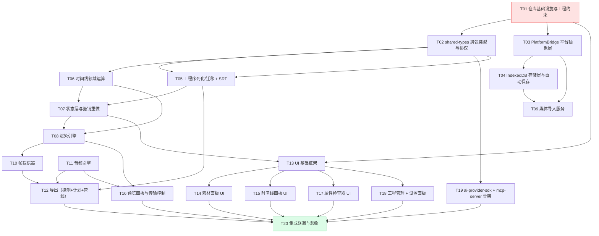

# ClipCut Web · V1.0 任务分解清单

> 项目：`clipcut-web` · 架构依据：[`docs/ARCHITECTURE.md`](./ARCHITECTURE.md) · 产品依据：[`docs/PRD.md`](./PRD.md)
> 任务总数：**20**（符合 12~20 区间）
> 排序规则：按**实现顺序**排列（前置依赖在前）；标 🔀 的任务可与同级任务并行开工
> 粒度约定：**一个任务 = 工程师一轮批量编写能完成的一个模块**，任务内文件通常 ≥ 3 个

---

## 0. 任务总览



**并行批次**

| 批次 | 可并行任务 | 说明 |
|---|---|---|
| 第 1 批 | T01 | 唯一起点 |
| 第 2 批 | T02、T03 | T02 纯类型、T03 纯平台 API，互不依赖 |
| 第 3 批 | T04、T05、T06、T19 🔀 | T19（两个骨架包）不依赖任何业务代码 |
| 第 4 批 | T07、T09、T10 前置准备 | T09 依赖 T03/T04 |
| 第 5 批 | T08、T11、T12（部分） | T08 依赖 T06/T07；T11 独立 |
| 第 6 批 | T12（收尾）、T13 | T13 是 UI 地基，需尽早并行 |
| 第 7 批 | T14、T15、T16、T17、T18 🔀 | 五个 UI 模块互不依赖，可分给多人 |
| 第 8 批 | T20 | 集成联调与验收 |

---

## T01 · 仓库基础设施与工程约束

| 项 | 内容 |
|---|---|
| **优先级** | P0 |
| **依赖** | 无（项目起点） |
| **涉及文件** | `package.json`、`pnpm-workspace.yaml`、`tsconfig.base.json`、`tsconfig.json`、`.npmrc`、`.editorconfig`、`.gitignore`、`.prettierrc.json`、`eslint.config.js`、`vitest.workspace.ts`、`.github/workflows/ci.yml`、`README.md`、`LICENSE`、`.env.example` |
| **涉及包** | 仓库根 |

**实现要点**

1. pnpm workspace 根 `package.json`：`private: true`，聚合脚本 `dev / build / preview / test / test:coverage / lint / lint:fix / typecheck / schema:check / check`。
2. `tsconfig.base.json`：`strict: true`、`target: ES2022`、`module: ESNext`、`moduleResolution: "bundler"`、`noUncheckedIndexedAccess: true`、`exactOptionalPropertyTypes: true`、`verbatimModuleSyntax: true`、`isolatedModules: true`。
3. **`eslint.config.js` 是本任务的灵魂**——三条分层硬规则：
   - **规则 A（零 window 文件/存储 API）**：`no-restricted-properties` + `no-restricted-globals`，禁止 `window.showOpenFilePicker` / `window.showSaveFilePicker` / `window.showDirectoryPicker` / `localStorage` / `sessionStorage` / `indexedDB` / `document.cookie`。**白名单**：`packages/app/src/platform/**`、`packages/app/src/services/storage/db.ts`（需加 `// eslint-disable-next-line` + 理由注释）。
   - **规则 B（零上传）**：`packages/app/src/domain/**` 与 `packages/app/src/services/media/**` 禁止 `fetch` / `XMLHttpRequest` / `navigator.sendBeacon` / `WebSocket`（仅白名单 `src/services/mcp/**` 与 `src/services/material/**` 可用）。
   - **规则 C（零厂商 SDK）**：`packages/ai-provider-sdk/**` 禁止 import 任何 `openai` / `@anthropic-ai` / `@google/generative-ai` / `azure` 等。
   - 同时配置 `eslint-plugin-react-hooks`（`rules-of-hooks` 报错、`exhaustive-deps` 警告）。
4. `vitest.workspace.ts`：两个工程——`packages/app`（环境 `happy-dom`，`include: ['src/**/*.test.ts(x)']`）与 `packages/shared-types`（环境 `node`）。
5. CI（`.github/workflows/ci.yml`）：`pnpm install --frozen-lockfile` → `lint` → `typecheck` → `test` → `build` → `schema:check` → 校验 `dist/` 产物为纯静态（不含 `node` 服务代码）。
6. `README.md`：快速开始（`pnpm i` → `pnpm dev`）、目录结构、架构图（引用 ARCHITECTURE.md）、许可、贡献指引。

**验收标准**

- [ ] `pnpm i && pnpm lint && pnpm typecheck && pnpm test && pnpm build` 全绿。
- [ ] 在 `packages/app/src/domain/timeline/operations.ts` 里写 `localStorage.getItem('x')` → lint 报错；在 `src/platform/` 里写 → 不报错。
- [ ] 在 `packages/app/src/services/media/probe.ts` 里写 `fetch(...)` → lint 报错。
- [ ] `pnpm -r build` 产出 4 个包的 `dist/`，app 的 `dist/` 全部为静态资源（`index.html` + assets）。
- [ ] CI workflow 文件存在且 YAML 合法。

---

## T02 · shared-types：跨包类型与协议

| 项 | 内容 |
|---|---|
| **优先级** | P0 |
| **依赖** | T01 |
| **涉及文件** | `packages/shared-types/package.json`、`tsconfig.json`、`README.md`、`src/index.ts`、`src/project.ts`、`src/ai-capabilities.ts`、`src/mcp/tools.ts`、`src/mcp/protocol.ts`、`src/common.ts`、`src/time.ts` |
| **涉及包** | `packages/shared-types` |

**实现要点**

1. `src/project.ts`：**严格照抄** ARCHITECTURE.md §5 的全部类型（`ProjectDoc`/`Track`/`Clip`/`Asset`/`SubtitleDoc`/`ProjectSettings`/`CanvasSettings`/`ExportSettings`/`ProviderConfig`/`ProjectMeta`…）。所有含可扩展结构的接口带 `[extra: string]: unknown` 索引签名以保留未知字段。
2. `src/time.ts`：`msToFrames(ms, fps)`、`framesToMs(frame, fps)`、`formatTimecode(ms, fps)` → `HH:MM:SS:FF`、`formatDuration(ms)` → `mm:ss` / `hh:mm:ss`、`parseTimecode(str)`、`roundMs(n)`。
3. `src/ai-capabilities.ts`：`AICapability` 七能力联合类型、`AIInputMap`、`AIOutputMap`、`AIProgressEvent`。
4. `src/mcp/tools.ts`：15 个工具的入参/出参 TS 类型 + **每工具一份 JSON Schema 常量**（供 MCP Server 直接注册）。
5. `src/mcp/protocol.ts`：`MCP_PROTOCOL_VERSION`、`McpChannelMessage` 联合类型、`McpErrorCode` 枚举。
6. `src/common.ts`：`Result<T>`、`Disposable`、`Mutable<T>` 等通用类型。
7. **零运行时依赖**（`dependencies: {}`），`package.json` 里 `exports` 指向 `dist/index.js` + `types`，并 `typesVersions` 兼容 TS 5.7。
8. `src/index.ts` 统一 re-export；`README.md` 写明"只含类型与协议，零运行时依赖，可被任意外部项目引用"。

**验收标准**

- [ ] `pnpm --filter shared-types build` 通过，产出 `.d.ts`。
- [ ] `tsc --noEmit` 消费方（app）能 `import type { ProjectDoc } from '@clipcut/shared-types'`。
- [ ] 15 个工具的 JSON Schema 均可通过 `ajv` 编译校验。
- [ ] `package.json` 的 `dependencies` 为空对象。

---

## T03 · PlatformBridge 平台抽象层

| 项 | 内容 |
|---|---|
| **优先级** | P0 |
| **依赖** | T01 |
| **涉及文件** | `packages/app/src/platform/PlatformBridge.ts`、`WebPlatformBridge.ts`、`capabilities.ts`、`fileTypes.ts`、`errors.ts`、`index.ts`、`packages/app/vite.config.ts`（别名配置） |
| **涉及包** | `packages/app` |

**实现要点**

1. `PlatformBridge.ts`：ARCHITECTURE.md §6.1 的接口 + `PlatformCapabilities` 类型。**业务层只允许依赖此接口**。
2. `WebPlatformBridge.ts`：
   - `readFile`：优先 `window.showOpenFilePicker`（多选时 `multiple: true`），不可用时降级构造隐藏 `<input type="file" multiple>`；返回 `File[]`。
   - `saveFile`：`showSaveFilePicker` 可用则写入；否则 `URL.createObjectURL` + `<a download>` 触发下载，**并在 1s 后 `revokeObjectURL`**。
   - `listFiles`：`showDirectoryPicker` 遍历目录（递归深度上限 2）返回 `File[]`；不支持时抛 `UnsupportedOperationError`。
   - `storage`：`localStorage` 的隔离实现（带 `clipcut:` 前缀 + JSON 序列化）——**注意**：这是平台层，允许直用。
   - `getMediaDuration`：创建离屏 `<video>`/`<audio>`，`loadedmetadata` 后读 `duration`。
3. `capabilities.ts`：
   - `VideoEncoder.isConfigSupported` 探测 `avc1.42E01E`(H.264 baseline)、`avc1.640028`(H.264 high)、`hvc1.1.6.L93.B0`(HEVC)、`vp09.00.10.08`(VP9)、`av01.0.04M.08`(AV1)。
   - `AudioEncoder` 探测 `mp4a.40.2`(AAC)、`opus`。
   - `MediaRecorder.isTypeSupported` 探测 `video/webm;codecs=vp9,opus` 等。
   - `navigator.gpu`、`indexedDB`、`window.showOpenFilePicker`、`isMobile`（UA 判定）。
   - 探测结果**缓存**（模块级 memo），避免重复调用开销。
4. `fileTypes.ts`：支持格式白名单（`mp4/webm/mov/m4a/mp3/wav/ogg/jpg/jpeg/png/webp/gif`）→ `AssetType` 映射 + `isSupportedMime()`。
5. `errors.ts`：`PlatformError` / `UnsupportedOperationError` / `PermissionDeniedError`。
6. `index.ts`：导出接口 + `getPlatformBridge()` 单例工厂 + `ElectronPlatformBridge` 的**类型占位与 TODO 注释**（不实现）。

**验收标准**

- [ ] `grep -r "showOpenFilePicker" packages/app/src --include=*.ts` 仅命中 `platform/` 目录。
- [ ] `capability()` 在 Chrome 111 返回 `webCodecs: true` 且 `supportedVideoCodecs` 含 `avc1.*`。
- [ ] `readFile` 在不支持 FS Access API 的环境自动降级到 `<input type=file>` 且能取到 `File[]`。
- [ ] 单元测试覆盖 `fileTypes` 分类与 `capabilities` 的 mock 分支。

---

## T04 · IndexedDB 存储层与自动保存

| 项 | 内容 |
|---|---|
| **优先级** | P0 |
| **依赖** | T01、T03 |
| **涉及文件** | `packages/app/src/services/storage/db.ts`、`projectRepo.ts`、`blobRepo.ts`、`exportHistoryRepo.ts`、`settingsRepo.ts`、`autoSave.ts`、`index.ts` |
| **涉及包** | `packages/app` |

**实现要点**

1. `db.ts`：用 `idb` 打开 `clipcut-db`，**4 张表**：
   - `projects`：keyPath `projectId`；索引 `updatedAt`。
   - `blobs`：keyPath `key`（`blob:asset_x` / `thumb:asset_x` / `export:job_x` / `proxy:asset_x`）。
   - `exports`：keyPath `id`；索引 `at`。
   - `settings`：keyPath `key`。
2. `projectRepo.ts`：`listProjects()`（按 `updatedAt` **倒序**）、`saveProject(doc)`、`loadProject(id)`、`deleteProject(id)`（同时删关联 blob）。
3. `blobRepo.ts`：`putBlob(key, blob)`、`getBlob(key)`、`deleteBlob(key)`、`hasBlob(key)`、`getMissingBlobKeys(keys[])`（**relink 核心**）、`estimateUsage()`。
4. `exportHistoryRepo.ts`：写入导出历史，**只保留最近 10 条**。
5. `settingsRepo.ts`：语言/主题/Provider 配置/素材库 API Key 持久化。
6. `autoSave.ts`：
   - `scheduleAutoSave(getDoc, save)` —— 编辑后 **3s 防抖**（`debounce`），落盘时**只更新 `updatedAt`，不改 `schemaVersion`**。
   - `installBeforeUnloadFlush()` —— `beforeunload` + `visibilitychange(hidden)` 双保险，强制落盘。
   - 落盘失败（配额超限）→ `Toast` 友好提示，不阻塞编辑。

**验收标准**

- [ ] 刷新页面后工程与素材完整恢复（FR-002①）。
- [ ] DevTools → Application → IndexedDB 可见 `projects` 与 `blobs` 记录（FR-002②）。
- [ ] 单工程支持 ≥ 500MB 素材：`localStorage` 中**不含**任何素材数据（FR-002③）。
- [ ] `listProjects()` 结果严格按 `updatedAt` 倒序。
- [ ] 自动保存不产生新版本号（`schemaVersion` 恒为 `1.0.0`）。
- [ ] 单元测试用 `fake-indexeddb` 覆盖 CRUD 与 `getMissingBlobKeys`。

---

## T05 · 工程序列化/迁移 + SRT 字幕解析

| 项 | 内容 |
|---|---|
| **优先级** | P0 |
| **依赖** | T02 |
| **涉及文件** | `packages/app/src/domain/project/serialize.ts`、`deserialize.ts`、`migrate.ts`、`duration.ts`、`factory.ts`、`validation.ts`、`index.ts`、`packages/app/src/domain/subtitles/srt.ts`、`index.ts`、`schema/project.schema.json`、`fixtures/minimal.clipcut.json`、`fixtures/full.clipcut.json`、`fixtures/legacy-0.9.clipcut.json` |
| **涉及包** | `packages/app`、仓库根 |

**实现要点**

1. `schema/project.schema.json`：JSON Schema draft 2020-12，覆盖 PRD §4 全部字段；**对象层 `additionalProperties: true`**（支持未知字段）；`required` 列出必填项；`schemaVersion` 用 `pattern: "^\\d+\\.\\d+\\.\\d+$"`。
2. `validation.ts`：Ajv 8 实例（`allErrors: true`），`validateProjectDoc(json)` 返回结构化错误列表（path + message + 中文提示）。
3. `deserialize.ts`：
   - Ajv 校验 → 通过后**在原对象上覆盖已知字段**（不白名单重建），**保留未知字段**。
   - `schemaVersion` 分派到 `migrate.ts`。
   - 加载后立即 `computeProjectDuration` 覆盖 `meta.durationMs`（派生值）。
   - 时间字段统一 `Math.round`。
4. `migrate.ts`：
   - 迁移函数注册表 `Record<string, (doc) => doc>`，当前实现 `0.9.x → 1.0.0`（补 `settings.ai.providers` 默认值、clips 补 `zIndex`/`transform` 默认值）。
   - **高版本拒绝**：`semverGt(version, CURRENT)` → 抛 `UnsupportedSchemaVersionError`（FR-004③）。
   - 低版本缺字段 → **走兼容层补默认值，不抛异常**（FR-001③）。
5. `serialize.ts`：`serialize(doc)` → 时间 `Math.round`、剥离派生缓存、**保留未知字段**、键序稳定（保证逐字节一致）。
6. `duration.ts`：`computeProjectDuration(doc)`（ARCHITECTURE.md §5.1）。
7. `factory.ts`：`createEmptyProject(name)`（默认 2 视频 + 2 音频 + 1 文字轨，`order` 递增）、`createDefaultTracks()`。
8. `subtitles/srt.ts`：
   - `parseSrt(content)`：支持 `HH:MM:SS,mmm` 与 `HH:MM:SS.mmm`；**逐行容错**（非法行跳过并计数，不中断）；按 `startMs` 排序；**重叠区间检测并返回警告列表**；≥2000 条不 OOM。
   - `stringifySrt(cues)`：与 parse 往返一致率 100%。
   - `detectOverlaps(cues)`。

**验收标准**

- [ ] **保存 → 加载 → 再保存，`JSON.stringify` 结果逐字节一致**（FR-001①）。
- [ ] 3 个 fixture 全部通过 Ajv 校验且反序列化不抛异常。
- [ ] 往 fixture 塞一个未知字段 `"customFoo": 123`，往返后该字段**原样保留**。
- [ ] `schemaVersion: "2.0.0"` 的文件 → 明确报错"文件版本过高"，不静默失败。
- [ ] SRT 导入含 3 个非法行 → 成功导入其余条目并返回 `errorCount: 3`。
- [ ] SRT 导出再导入，往返一致率 100%。
- [ ] `domain/**` 的所有文件在 Node 环境下可直接被 Vitest 跑（无 DOM 依赖）。

---

## T06 · 时间线领域运算

| 项 | 内容 |
|---|---|
| **优先级** | P0 |
| **依赖** | T02 |
| **涉及文件** | `packages/app/src/domain/timeline/operations.ts`、`invariants.ts`、`snapping.ts`、`selectors.ts`、`transform.ts`、`index.ts` |
| **涉及包** | `packages/app` |

**实现要点**

1. `operations.ts`：**clip 数据的唯一写入口**。实现 ARCHITECTURE.md §6.4 的全部函数，全部用 Immer `produceWithPatches` 返回 `{ doc, patches, inversePatches }`。
   - `addClip`：跨类型轨道**禁止**（视频 clip 不能拖到音频轨；音频→音频轨可以）；图片拖到视频轨默认 5s 时长；自动吸附到播放头/相邻 clip 边缘。
   - `moveClip`：同轨改 `startMs`，跨轨改所属轨道（需类型兼容校验）。
   - `trimClip`：左边缘改 `inMs`、右边缘改 `outMs`；**钳制** `inMs ≥ 0`、`outMs ≤ asset.durationMs`；最小 100ms。
   - `splitClip`：两侧共享 `assetId`、独立 `inMs/outMs`；分割点在首尾 1 帧内 → 抛 `NotSplittableError`。
   - `setClipSpeed`：保持 `inMs/outMs` 不变，**重算 `durationMs = (outMs - inMs) / speed`**。
   - `setClipProperty(path, value)`：`path` 形如 `audio.gain` / `transform.scale` / `text.fontSize`（白名单路径，防止越权写入）。
   - `duplicateClip` / `deleteClip` / `addTrack` / `removeTrack` / `setTrackFlags`。
2. `invariants.ts`：`fixClipDuration` / `assertClipInvariants` / `MIN_CLIP_DURATION_MS = 100`；**每次操作结束自动跑一次 `fixClipDuration`**。
3. `snapping.ts`：`collectSnapCandidates(doc, excludeClipIds)`（播放头、其他 clip 首尾、整秒刻度）→ `findSnap(candidateMs, candidates, pxPerSecond, thresholdPx=8)` → 命中返回 `{ ms, guide }`。
4. `selectors.ts`：`clipsAtTime(doc, ms)`、`visibleVideoTracks(doc)`（`order` 升序，`hidden` 排除）、`clipEndMs(clip)`、`orderedTracks(doc)`、`findClip(doc, clipId)`。
5. `transform.ts`：`applyCanvasResize(doc, newW, newH)` —— `transform.x/y` 按新旧宽高比换算、`text.fontSize` 按新画布高度 / 1080 换算。

**验收标准**

- [ ] 任何 clip 变更后 `durationMs === Math.round((outMs - inMs) / speed)` **恒成立**（单测覆盖全部操作）。
- [ ] 裁剪不越界：`inMs ≥ 0`、`outMs ≤ asset.durationMs` 越界时被钳制。
- [ ] 最小 clip 时长 100ms 生效。
- [ ] 分割点在 clip 首尾 1 帧内 → 抛明确错误。
- [ ] 跨类型轨道拖拽 → 抛 `IncompatibleTrackError`。
- [ ] `speed` 从 1 改 2 → `durationMs` 减半、`inMs/outMs` 不变。
- [ ] 吸附阈值 8px，关闭吸附后完全自由。
- [ ] `applyCanvasResize` 后视觉位置保持一致（`transform.x/y` 与 `fontSize` 换算正确）。
- [ ] `domain/**` 零 DOM 依赖、零 `window.*` 引用（lint 规则 A 生效）。

---

## T07 · 状态层与撤销重做

| 项 | 内容 |
|---|---|
| **优先级** | P0 |
| **依赖** | T05、T06 |
| **涉及文件** | `packages/app/src/state/projectStore.ts`、`historyStore.ts`、`uiStore.ts`、`playbackStore.ts`、`selectors.ts`、`actions.ts`、`storeMiddleware.ts`、`index.ts` |
| **涉及包** | `packages/app` |

**实现要点**

1. `projectStore.ts`：Zustand store 持有 `doc: ProjectDoc` + `selectedClipIds: string[]` + `dirty: boolean`；**只暴露 `applyOperation()` 一个写入口**。
2. `historyStore.ts`：`past/future: Patch[][]`，上限 100（要求 ≥50）；`push(inversePatches)` / `undo()` / `redo()` / `reset()`（工程保存后调用 reset，FR-059②）。
3. `uiStore.ts`：`selectedClipIds`、`selectedTrackId`、`pxPerSecond`（0.5 ~ 200）、`scrollLeft`、`snapEnabled`、`dragSession`（瞬态）、`panelWidths`、`activeDialog`。
4. `playbackStore.ts`：`currentTimeMs`、`isPlaying`、`playbackRate`；提供 `subscribeFrame(cb)` 供命令式消费（**不触发 React 渲染**）。
5. `actions.ts`：**所有用户可见编辑动作的集中定义**。每条动作 = 一次 `applyOperation` = **一条历史记录**。覆盖：新增/移动/裁剪/分割/删除/复制粘贴/多选/变速/音量/静音/变换/文字样式/字幕增删改/轨道增删/轨道标志/画布设置/画中画开关/撤销重做。
6. `storeMiddleware.ts`：
   - 订阅 `projectStore` 变更 → 标脏 + `scheduleAutoSave`。
   - 安装 `beforeunload` 强制落盘。
   - 动作执行后把 `selectedClipIds` 收敛到仍存在的 clip（避免悬空选中）。
7. `selectors.ts`：memoized 组合选择器（`selectClipsOnTrack`、`selectVisibleClips`、`selectProjectDuration`、`selectActiveOverlayClips`）。

**验收标准**

- [ ] 连续 60 次编辑后连续撤销 60 次，状态完全回到初始（`history.test.ts` 用深比较断言）。
- [ ] **一次拖拽只产生一条历史记录**（抬手提交一次）。
- [ ] 撤销栈在工程保存后被重置。
- [ ] `applyOperation` 之外的写 doc 路径**不存在**（代码审查 + grep 校验）。
- [ ] 播放态更新不引起任何组件重渲染（用 React DevTools Profiler 或 render 计数断言）。

---

## T08 · 渲染引擎（Canvas 2D 合成）

| 项 | 内容 |
|---|---|
| **优先级** | P0 |
| **依赖** | T06、T07 |
| **涉及文件** | `packages/app/src/render/compositor.ts`、`drawImage.ts`、`drawText.ts`、`drawTransform.ts`、`frameCache.ts`、`index.ts` |
| **涉及包** | `packages/app` |

**实现要点**

1. `compositor.ts`：
   - `renderFrame(ctx, doc, timeMs, opts)` —— **导出与预览共用的唯一合成入口**。
   - 顺序：清屏（`canvas.backgroundColor`）→ 视频轨按 `order` **从下往上** → `isOverlay` 画面按 `zIndex` 叠在主画面之上（**最多 4 层 PIP**，超出丢弃并告警）→ 文字轨 → 字幕（若 `burnIn`）。
   - `hidden` 轨与 `muted` 处理：`hidden` 轨不参与渲染。
   - 源时间换算：`sourceMs = clip.inMs + (timeMs - clip.startMs) * clip.speed`。
2. `drawImage.ts`：`fit` 三模式（contain/cover/fill）计算目标矩形；`transform` 应用（x/y 画布比例、scale、rotation 绕中心、opacity、`cornerRadius` 圆角裁剪）。
3. `drawText.ts`：多行换行（按 `fontSize` 与 `maxWidth` 折行）、描边（`strokeText` + `lineWidth`）、背景色矩形、行高、字间距（`ctx.letterSpacing` 降级为逐字符绘制）、水平/垂直对齐。
4. `drawTransform.ts`：`transform` → Canvas 变换矩阵计算，**PIP 与文字共用同一实现**（FR-030）。
5. `frameCache.ts`：LRU 缓存 `assetId + 时间桶(100ms) → ImageBitmap`，容量上限 + `release()` 释放。

**验收标准**

- [ ] 轨道 `order` 小的在下、大的在上（单测断言绘制调用顺序）。
- [ ] `hidden` 轨的 clip 不出现在渲染调用中。
- [ ] 文字换行、描边、背景、对齐在 canvas 上正确呈现（截图对比基线）。
- [ ] `transform` 的 scale/rotation/opacity/cornerRadius 全部生效。
- [ ] PIP 超过 4 层时只渲染前 4 层并输出告警。
- [ ] `renderFrame` 是**纯函数式的绘制**，不持有状态，可被导出管线复用。

---

## T09 · 媒体导入服务

| 项 | 内容 |
|---|---|
| **优先级** | P0 |
| **依赖** | T03、T04 |
| **涉及文件** | `packages/app/src/services/media/assetService.ts`、`metadataProbe.ts`、`thumbnailService.ts`、`waveformService.ts`、`index.ts` |
| **涉及包** | `packages/app` |

**实现要点**

1. `metadataProbe.ts`：
   - 视频：`HTMLVideoElement` 读 `duration/width/height`；`videoWidth` 有效且 `canPlayType` 失败 → `playable: false`（如部分 `.mov`）。
   - 音频：`AudioContext.decodeAudioData` → `duration` + `hasAudio: true`。
   - 图片：`Image` 解码 → `width/height`，`durationMs = 0`。
   - **任何解析失败都不阻塞导入**：`durationMs = 0`、`playable = false`、UI 标注"未知时长"。
   - `frameRate`：优先从容器读取（配合 T10 的 mp4box），失败则给默认值 30。
2. `thumbnailService.ts`：视频取**第 1s 帧** → `createImageBitmap` → PNG Blob → 存 `blobs`（`thumb:asset_x`）→ 写回 `asset.thumbnailBlobKey`；二次打开工程**不重新生成**（blob 已存在则复用）。
3. `waveformService.ts`：解码 PCM → 分桶取**峰值**（每桶取 max abs）→ 归一化到 0~1 → **默认 400 个采样点**；存 `asset.waveform`。
4. `assetService.ts`：`importFiles(File[])` 编排（探测 → 缩略图/波形 → `putBlob` → `addAsset` 一次历史记录），返回 `{ imported, failed, reasons[] }`；不支持格式返回明确原因（不静默失败）。

**验收标准**

- [ ] 单次可多选导入 ≥ 20 个文件。
- [ ] 不支持格式返回明确错误原因，UI 以 Toast 呈现。
- [ ] `.mov` 无法解码 → 导入成功但 `playable: false` + "需转码"标记。
- [ ] 元数据解析失败 → `durationMs = 0`，导入**不失败**。
- [ ] 缩略图二次打开工程**不重新生成**（断言 blob 写入次数为 1）。
- [ ] 波形为 400 个 0~1 归一化数值。

---

## T10 · 帧提供器（导出取帧）

| 项 | 内容 |
|---|---|
| **优先级** | P0（**高风险任务**） |
| **依赖** | T08（渲染引擎的调用契约） |
| **涉及文件** | `packages/app/src/services/media/frameProviders/types.ts`、`mp4DecoderProvider.ts`、`elementProvider.ts`、`index.ts`、`packages/app/package.json`（新增 `mp4box` 依赖） |
| **涉及包** | `packages/app` |

**实现要点**

1. `types.ts`：
   ```ts
   interface FrameProvider {
     readonly kind: 'mp4-decoder' | 'element';
     readonly supports: (asset: Asset) => boolean;
     getFrameAt(assetId: string, sourceMs: number): Promise<ImageBitmap>;
     dispose(): void;
   }
   ```
2. `mp4DecoderProvider.ts`（**主路径**）：
   - 用 `mp4box` 解析 MP4 → 拿到 sample 表（时间戳、关键帧标记、codec 描述串）。
   - `VideoDecoder` 配置 `codec`（来自 sample description）+ `optimizeForLatency: true`；`VideoFrame` → `createImageBitmap` 交给调用方（**注意 `VideoFrame.close()` 必须在拷贝后调用**，否则画面为空）。
   - **GOP 帧缓存**：以关键帧为起点向前解，只保留最近 N 帧（N ≤ 32）防止内存爆；随机 seek 时若目标不在缓存则重解该 GOP。
   - 每个 asset 一个 `VideoDecoder` 实例，用完 `close()`。
3. `elementProvider.ts`（**降级路径**）：`HTMLVideoElement` `currentTime = ms/1000` → `await seeked` → `createImageBitmap(video)`；用于 WebM / 未知容器 / 无 WebCodecs 环境。
4. `index.ts`：工厂 `createFrameProvider(asset)` —— 优先 mp4-decoder（`supports` 检查 MIME + `VideoDecoder.isConfigSupported`），否则 element；`disposeAll()` 统一释放。

**验收标准**

- [ ] MP4 素材在 WebCodecs 可用环境下走 decoder 路径；WebM/无 WebCodecs 走 element 路径。
- [ ] `getFrameAt` 返回的 `ImageBitmap` 尺寸正确且**不是空白帧**（像素采样断言）。
- [ ] 随机 seek 10 次结果帧内容正确（与 `elementProvider` 对比抽样一致）。
- [ ] 长时间导出后内存不持续增长（GOP 缓存有上限断言）。
- [ ] 所有 `VideoDecoder` / `VideoFrame` 在 `dispose()` 后释放。

---

## T11 · 音频引擎（混音总线 + 离线渲染 + 变速保音高）

| 项 | 内容 |
|---|---|
| **优先级** | P0（**高风险任务**） |
| **依赖** | T03 |
| **涉及文件** | `packages/app/src/services/media/audioEngine.ts`、`packages/app/src/services/media/worklets/pitchPreserveStretchProcessor.ts`、`packages/app/src/services/media/frameProviders/../audioGraph.ts`（拓扑共享层） |
| **涉及包** | `packages/app` |

**实现要点**

1. `audioGraph.ts`（**关键抽象**）：`buildAudioGraph(context, doc, timeMs)` —— 把工程音频拓扑构建到**任意** `BaseAudioContext`（`AudioContext` 或 `OfflineAudioContext`）：
   - 每条未 `muted` 音频轨 + 视频轨的音频 → 各自 GainNode（`clip.audio.gain`）→ 淡入淡出包络（线性 `setValueCurveAtTime`）→ 轨道总线 → **主混音总线**（`masterGain`）→ `context.destination`。
   - 变速 clip：源用 `AudioBufferSourceNode`（`playbackRate = speed`）；若 `speed ≠ 1` 且需保音高，链上挂 **WSOLA AudioWorklet**。
   - **预览与导出使用同一份 `audioGraph.ts`**（FR-035"同一条总线"的落地方式：同一拓扑代码 + 同一增益计算，只有 context 类型不同）。
2. `audioEngine.ts`（预览侧）：
   - `AudioContext` 懒创建（首次用户手势后 `resume()`）。
   - 播放/暂停/跳转时重建或重启 source 节点，对齐 `currentTimeMs`。
   - 元素 → `MediaElementAudioSourceNode` → 图。
3. `worklets/pitchPreserveStretchProcessor.ts`（**WSOLA 变速保音高，FR-020③**）：
   - 经典 WSOLA：搜索窗内寻找与原波形最相似的重叠段，做交叉淡化拼接。
   - 以 `AudioWorkletProcessor` 实现，参数 `rate`（0.1~10）。
   - 通过 `audioWorklet.addModule` 加载（需处理 CSP/路径失败降级）。
   - **降级路径**：worklet 加载失败时 → 退化为普通 `playbackRate`（音高会变）并在 UI/日志明确告警。
4. 混音总线的**主时钟**：`playbackStore.currentTimeMs` 以 `AudioContext.currentTime` 为基准（音频存在时），保证音画同步。

**验收标准**

- [ ] 预览与导出使用**同一份** `buildAudioGraph` 代码（代码审查确认）。
- [ ] 多轨音频（2 轨音乐 + 1 轨视频原声）同时播放，音量比例正确。
- [ ] `gain` 0~2 实时可听（预览中调节立即生效）。
- [ ] 淡入淡出线性可听（0.5s 渐变）。
- [ ] `speed = 2` 时音频**音高不变**（可用 `OfflineAudioContext` 渲染后 FFT 主频断言）；worklet 失败时降级路径可用且有告警。
- [ ] 裁剪/变速后音频与视频同步跟随（±40ms 内）。

---

## T12 · 导出：能力探测 + 计划 + 管线

| 项 | 内容 |
|---|---|
| **优先级** | P0 |
| **依赖** | T02、T05、T08、T10、T11 |
| **涉及文件** | `packages/app/src/domain/export/exportPlan.ts`、`index.ts`、`packages/app/src/services/export/capabilityProbe.ts`、`exportController.ts`、`webCodecsExporter.ts`、`mediaRecorderExporter.ts`、`audioExporter.ts`、`download.ts`、`index.ts` |
| **涉及包** | `packages/app` |

**实现要点**

1. `capabilityProbe.ts`：产出 §9.1 的 `CodecMatrix`；对 `H.264 / HEVC / VP9 / AV1 / AAC / Opus` 逐一 `isConfigSupported`；含 `preferredExport`（**动态选择，不硬编码默认值**，PRD Q1 决策）。
2. `exportPlan.ts`（领域层，纯净函数）：
   - `buildExportPlan(doc, settings)` → 总帧数 `round(durationMs/1000*fps)`、视频/音频目标参数、预计码率。
   - **非法组合检测**：4K@60 超出编码器能力 → 返回 `{ errors, suggestions: ['降至 30fps', '降至 1080p'] }`。
   - 分辨率预设：跟随画布 / 720p / 1080p / 4K。
3. `webCodecsExporter.ts`（**主路径**）：
   - 逐帧离线渲染（**无实时约束**）：`renderFrame` → `VideoFrame(canvas, { timestamp })` → `VideoEncoder.encode` → `mp4-muxer.addVideoChunk`。
   - 关键帧间隔：每 2s 一个 keyframe。
   - 音频：`OfflineAudioContext` 渲染混音总线 → 切 1024 samples/帧的 `AudioData` → `AudioEncoder` → mux。
   - `finalize()` → `Blob`。
4. `mediaRecorderExporter.ts`（**兜底**）：
   - `canvas.captureStream(fps)` + `AudioContext.createMediaStreamDestination()` → 合并流 → `MediaRecorder`（仅 WebM）。
   - **实时录制**：需提示"请勿切走标签页"；导出中禁用其他导出但**允许继续编辑**。
   - WebCodecs 不可用时**自动切换**并提示"性能较低导出模式"，不报错不阻断。
5. `exportController.ts`：编排（探测 → 选路径 → 进度事件 → 取消 → 落库 → 触发下载）；进度含 `当前时间 / 总时长 / 已用时 / 预计剩余`；`AbortController` 取消 → `encoder.close()` + mux 释放 + ObjectURL revoke（**无内存泄漏**）。
6. `audioExporter.ts`：独立音频导出，导出**混音总线**结果；MP3 视 `AudioEncoder` 支持，不支持则降级 WAV 并明示。
7. `download.ts`：`URL.createObjectURL` + `<a download>` + 及时 `revokeObjectURL`。
8. 导出历史写入 `exportHistoryRepo`（最近 10 条：时间/时长/大小/格式）。

**验收标准**

- [ ] Chrome 111+ 导出 MP4 成功，产物时长与工程误差 ≤ 1 帧，音画同步误差 ≤ 40ms。
- [ ] 1080p30 / 1 分钟素材导出耗时 ≤ 30s。
- [ ] WebCodecs 不可用时自动切 MediaRecorder，UI 提示"性能较低导出模式"，不抛错。
- [ ] 4K@60 组合给出明确提示 + 自动降级建议。
- [ ] 导出中点"取消" → 编码器与 muxer 均 `close()`，无内存泄漏（DevTools Memory 观察）。
- [ ] 导出历史持久化到 IndexedDB，刷新后仍在，且只保留 10 条。
- [ ] 导出完成后自动触发浏览器下载。

---

## T13 · UI 基础框架（布局 / 主题 / 通用组件 / i18n）

| 项 | 内容 |
|---|---|
| **优先级** | P0 |
| **依赖** | T01（可与 T02~T12 大部分并行开工） |
| **涉及文件** | `packages/app/src/main.tsx`、`App.tsx`、`styles.css`、`vite-env.d.ts`、`src/components/layout/AppLayout.tsx`、`TopToolbar.tsx`、`StatusBar.tsx`、`PanelResizer.tsx`、`WorkspaceTabs.tsx`、`src/components/common/*`（16 个）、`src/i18n/index.ts`、`src/i18n/locales/zh-CN.ts`、`en-US.ts`、`src/utils/*`（6 个） |
| **涉及包** | `packages/app` |

**实现要点**

1. Tailwind 3 配置（`tailwind.config.js` + `postcss.config.js`）：暗色单主题 + **CSS 变量设计令牌**（`--cc-bg-*` / `--cc-accent` / `--cc-track-*`），预留 `data-theme` 钩子。
2. `AppLayout.tsx`：**三栏 + 底部时间线** 布局（对齐 PRD §5.1 ASCII 线框）：左素材库 / 中预览 / 右属性面板 / 底时间线 / 顶工具栏。
3. 通用组件（Radix 封装，Tailwind 造型）：`Button`、`IconButton`、`Dialog`、`Tabs`、`Select`、`Slider`、`NumberField`、`TextField`、`Checkbox`、`Tooltip`、`ContextMenu`、`Toast`、`ConfirmDialog`、`UndoToast`、`FileDropOverlay`、`EmptyState`。
4. `i18n/index.ts`：**自研轻量 i18n**（约 80 行）——`initI18n(lang)`、`t(key, vars)`、`useTranslation()`、语言切换持久化到 `settingsRepo`；字典 `zh-CN.ts` / `en-US.ts` **覆盖全部 UI 文案**（FR-058）。
5. `utils/`：`id.ts`（`projectId` uuid v4 + `asset_/clip_/track_/cue_` 前缀）、`time.ts`、`format.ts`、`throttle.ts`、`clsx.ts`、`dom.ts`、`color.ts`。
6. `App.tsx`：视图路由（工程列表 ↔ 编辑器工作区）、全局 `ConfirmDialog` 宿主、全局 `Toast` 宿主、**全局快捷键作用域**注册。
7. `TopToolbar.tsx`：**只搭骨架**（工程操作按钮组、传输控制占位、时间码显示、设置入口）——实际行为在 T16/T17/T18 接入。

**验收标准**

- [ ] 界面骨架与 PRD §5.1 ASCII 线框一致（四区布局可拖拽调整侧栏宽度）。
- [ ] 全部 UI 文案走 `t()`，**代码中无硬编码中文/英文 UI 字符串**（grep 校验）。
- [ ] 切换语言后界面文案整体切换，且**文案覆盖率 100%**（无 key 缺失回退到 key 本身）。
- [ ] 通用组件具备键盘可访问性（焦点可见、ESC 关闭对话框）。
- [ ] `AppLayout` 渲染 0 个业务数据（纯布局），方便并行开发。

---

## T14 · 素材面板 UI

| 项 | 内容 |
|---|---|
| **优先级** | P0 |
| **依赖** | T07、T09、T13 |
| **涉及文件** | `packages/app/src/components/media/MediaPanel.tsx`、`MediaGrid.tsx`、`MediaCard.tsx`、`MediaToolbar.tsx`、`MediaDropZone.tsx` |
| **涉及包** | `packages/app` |

**实现要点**

1. `MediaPanel.tsx`：本地素材列表主体；底部 tab（本地 / 在线库(P1) / 连接器(P1)）；导入按钮。
2. `MediaToolbar.tsx`：搜索框（**200ms 防抖**）、类型筛选（全部/视频/音频/图片）、导入按钮。
3. `MediaGrid.tsx` / `MediaCard.tsx`：网格 + 列表两种视图（`MediaCard` 复用两种布局）；展示缩略图、名称、类型图标、时长、分辨率；**`IntersectionObserver` 懒加载缩略图**；滚动 60fps。
4. 交互：双击素材 → 追加到时间线播放头处；`F2` 重命名；`Delete` 删除（二次确认）；多选（`Shift`/`Ctrl`）批量删除；**HTML5 拖拽源**（`dataTransfer.setData('application/x-clipcut-asset', assetId)`）。
5. `MediaDropZone.tsx`：拖入文件 → 调用 `assetService.importFiles` → Toast 反馈。

**验收标准**

- [ ] 搜索防抖 200ms，输入时不卡顿。
- [ ] 缩略图懒加载生效（滚动时只加载可见项）。
- [ ] 拖拽素材到时间线能生成 clip（与 T15 联调）。
- [ ] `F2` 重命名、`Delete` 二次确认删除均生效。
- [ ] 双击素材追加到播放头处。

---

## T15 · 时间线面板 UI（核心交互）

| 项 | 内容 |
|---|---|
| **优先级** | P0（**最重任务**） |
| **依赖** | T05、T06、T07、T13 |
| **涉及文件** | `packages/app/src/components/timeline/TimelinePanel.tsx`、`TimelineToolbar.tsx`、`TimelineRuler.tsx`、`TrackHeader.tsx`、`TrackRow.tsx`、`ClipView.tsx`、`ClipTrimHandle.tsx`、`Playhead.tsx`、`SnapIndicator.tsx`、`TimelineContextMenu.tsx`、`WaveformCanvas.tsx`、`src/hooks/useVirtualizedRows.ts`、`useClipDrag.ts`、`useClipResize.ts` |
| **涉及包** | `packages/app` |

**实现要点**

1. `TimelinePanel.tsx`：轨道堆叠容器、横向滚动容器、缩放（`Ctrl+滚轮` 以鼠标为锚点）、纵向滚轨（滚轮）、空格+拖拽平移。
2. `TimelineRuler.tsx`：刻度随缩放自适应（ms / s / min）；点击跳转；播放头可拖拽；缩放范围 `0.5px/s ~ 200px/s`。
3. `TrackHeader.tsx`：粘性固定（不随横向滚动）；名称、mute、hide（仅视频轨）、lock、高度拖拽调整；拖拽轨道头**重排 order**。
4. `ClipView.tsx`：**性能核心**——
   - 位置用 `transform: translateX()`（GPU 友好），宽度 = `durationMs * pxPerSecond`。
   - 缩略图条 / 波形 / 边框 / 选中态 / PIP 特殊描边。
   - `React.memo` + 细粒度选择器订阅（只订阅自己的 clip）。
5. `useClipDrag.ts`：**拖拽期间零 React 渲染**——
   - `pointermove` 只改被拖 clip 的 `style.transform`（ref 直写）。
   - 吸附：调用 `domain/timeline/snapping.ts` 计算候选（播放头 / 其他 clip 首尾 / 整秒），阈值 8px，命中时显示 `SnapIndicator` 参考线。
   - `pointerup` **一次性**调用 `moveClip` → 提交 store → **1 条历史记录**。
   - 跨类型轨道拖拽 → 拖拽中显示"禁止"光标。
6. `useClipResize.ts`：左右边缘拖拽裁剪；实时显示精确时间码提示；越界钳制；最小 100ms。
7. `useVirtualizedRows.ts`：按 `scrollLeft / pxPerSecond` 计算可见时间窗，只挂载窗口内 clip（前后各 1 屏 overscan）；**拖拽中的 clip 强制保持挂载**。
8. `Playhead.tsx`：拖拽定位；播放时**直接改 `style.transform`**（不触发 React 渲染）。
9. `WaveformCanvas.tsx`：波形按 `assetId + 宽度桶` 缓存 `OffscreenCanvas`，跨桶才重绘（缩放不卡顿）。
10. `TimelineContextMenu.tsx`：右键菜单（分割 / 裁剪 / 变速 / 静音 / 设为画中画 / 删除）。
11. 快捷键（作用域内）：`Space` 播放暂停、`S` 分割、`Delete` 删除、`Ctrl+C/V` 复制粘贴、`Ctrl+A` 全选、`Shift+点击` 多选、`,`/`.` 逐帧、`Home`/`End`。
12. 锁定轨道：clip 不可拖拽/裁剪/删除，但可选中查看属性。

**验收标准**

- [ ] 拖拽/裁剪交互 **≥ 60fps**（DevTools Performance 录制验证）。
- [ ] 拖拽期间 React 渲染次数为 0（render 计数断言）。
- [ ] 一次拖拽只产生 **1 条**历史记录。
- [ ] 吸附命中时显示高亮参考线；关闭吸附后完全自由。
- [ ] 跨类型轨道拖拽被拒绝并有提示。
- [ ] 缩放范围 `0.5 ~ 200 px/s`，缩放时播放头时间位置保持不变。
- [ ] 12 轨 + 500 clip 时滚动仍流畅（虚拟化生效）。
- [ ] 隐藏轨不参与预览与导出；静音轨不参与混音。

---

## T16 · 预览面板与传输控制

| 项 | 内容 |
|---|---|
| **优先级** | P0 |
| **依赖** | T08、T11、T13 |
| **涉及文件** | `packages/app/src/components/preview/PreviewCanvas.tsx`、`PreviewPanel.tsx`、`PreviewControls.tsx`、`CanvasSettingsBar.tsx`、`src/hooks/useRenderLoop.ts`、`useHotkeys.ts`、`src/services/media/videoPool.ts` |
| **涉及包** | `packages/app` |

**实现要点**

1. `PreviewCanvas.tsx`：`<canvas>` 承载 `compositor.renderFrame` 输出；点击画面可选中对应 clip（命中测试）。
2. `useRenderLoop.ts`：rAF 循环；`playbackStore.currentTimeMs` 命令式读取（**不触发 React 渲染**）；仅在时间变化 > 1/帧 时重绘。
3. `videoPool.ts`：离屏 `<video>` 元素池（按 asset 复用）；`requestVideoFrameCallback` 做帧级同步；漂移 > 40ms 才 seek（避免抖动）。
4. `PreviewControls.tsx`：播放/暂停、上一帧/下一帧、跳到开头/结尾、`J K L`（快退/暂停/快进，倍速循环）、时间码显示（`HH:MM:SS:FF`）。
5. `CanvasSettingsBar.tsx`：画布比例预设（16:9 / 9:16 / 1:1 / 4:5 / 原始）；缩放模式（适配 / 填满 / 原始）；全屏。
6. `useHotkeys.ts`：全局快捷键；**输入框聚焦时自动禁用**（Space 在搜索框不触发播放）。
7. 画布比例变更时调用 `domain/timeline/transform.ts` 的 `applyCanvasResize`。

**验收标准**

- [ ] 播放中预览与播放头同步，误差 ≤ 1 帧。
- [ ] 1080p30 素材下预览稳定 ≥ 30fps。
- [ ] 逐帧步进精度 = `1/fps` 秒。
- [ ] 空格键在素材搜索框聚焦时**不**触发播放。
- [ ] `J K L` 快退/快进可用。
- [ ] 修改画布比例后所有 clip 视觉位置保持一致。
- [ ] 播放期间 React 渲染次数为 0（性能断言）。

---

## T17 · 属性检查器 UI

| 项 | 内容 |
|---|---|
| **优先级** | P0 |
| **依赖** | T07、T13（+ T08/T15 联调） |
| **涉及文件** | `packages/app/src/components/inspector/InspectorPanel.tsx`、`TransformSection.tsx`、`AudioSection.tsx`、`TextSection.tsx`、`SubtitleSection.tsx`、`ExportSection.tsx`、`AssetSection.tsx` |
| **涉及包** | `packages/app` |

**实现要点**

1. `InspectorPanel.tsx`：随选中对象动态切换分区；**无选中时显示导出设置**。
2. `TransformSection.tsx`：位置 X/Y（画布百分比）、缩放、旋转、不透明度、圆角、适配模式（`contain/cover/fill`）—— **PIP 与文字共用同一套 transform 组件**（FR-030）。
3. `AudioSection.tsx`：音量 gain（0~2，步进 0.01）、淡入/淡出、静音、变速（0.25/0.5/1/1.5/2/4 + 自定义 0.1~10）。
4. `TextSection.tsx`：多行内容编辑（双击进入、`Esc` 或点击外部保存）、字体/字号/字重/颜色/描边（颜色+宽度）/背景色/行高/对齐/垂直对齐/不透明度/字间距 + **3 组预设样式**（白字黑描边 / 黄字黑描边 / 白字半透明底）。
5. `SubtitleSection.tsx`：字幕轨开关、整体样式、**烧录进画面**开关、导出 SRT、cue 列表编辑（增删改）。
6. `ExportSection.tsx`：分辨率（跟随画布/720p/1080p/4K）、帧率（24/25/30/50/60）、格式（MP4/WebM）、视频码率、音频码率、**编码器能力矩阵**展示、开始导出按钮、进度卡（当前/总/已用/预计剩余）、取消按钮、导出历史列表。
7. `AssetSection.tsx`：素材信息、许可信息（在线素材）、"离线缺失"提示 + relink 入口。
8. 所有编辑走 `state/actions.ts`（保证可撤销）。

**验收标准**

- [ ] 文字样式在预览与导出结果中**完全一致**。
- [ ] 3 组文字预设一键套用。
- [ ] 音量在预览中实时可听。
- [ ] 变速面板选 2x → `durationMs` 立即重算且波形按新速度重绘。
- [ ] 字幕轨关闭 → 预览与导出均不含字幕。
- [ ] 导出面板显示 H.264/HEVC/VP9/AV1/AAC/Opus 各自可用性。
- [ ] 属性面板的所有修改**可撤销**。

---

## T18 · 工程管理 + 设置面板

| 项 | 内容 |
|---|---|
| **优先级** | P0 |
| **依赖** | T04、T05、T13（+ T19 的 Provider 类型） |
| **涉及文件** | `packages/app/src/components/project/ProjectList.tsx`、`ProjectCard.tsx`、`NewProjectDialog.tsx`、`ImportProjectDialog.tsx`、`RelinkDialog.tsx`、`src/components/settings/SettingsDialog.tsx`、`ProviderSettingsTab.tsx`、`CapabilitiesTab.tsx`、`AboutTab.tsx` |
| **涉及包** | `packages/app` |

**实现要点**

1. `ProjectList.tsx`：工程列表（名称、更新时间、时长、缩略图），按 `updatedAt` **倒序**；可创建 ≥ 10 个工程并切换；删除二次确认。
2. `NewProjectDialog.tsx`：新建（名称、画布预设、帧率）。
3. `ImportProjectDialog.tsx`：导入 `.clipcut.json` → 校验 `schemaVersion`（高版本拒绝并提示）→ 反序列化 → 比对 `blobKey` 找缺失素材 → 报告"离线缺失"清单。
4. `RelinkDialog.tsx`：为缺失素材重新定位本地文件 → 更新 `blobKey` → 恢复 `playable`。
5. `ExportProjectDialog`（并入 `ProjectList` 工具栏）：导出 `.clipcut.json` 到本地。
6. `SettingsDialog.tsx`：四个 tab（通用 / AI Provider / 导出能力 / 关于）。
7. `ProviderSettingsTab.tsx`：按能力逐一选择 Provider；填 `baseUrl/model/apiKey`（Key **掩码显示** `sk-****abcd`）+ 明确提示"Key 仅存储在你本地浏览器"；支持配置导入/导出。
8. `CapabilitiesTab.tsx`：浏览器兼容矩阵（Chrome/Edge 111+ 全功能、Safari 16.4+ 降级、Firefox WebCodecs 有限）+ 编码器矩阵（FR-044、FR-060）。
9. `AboutTab.tsx`：版本、许可证、兼容提示。

**验收标准**

- [ ] 可创建 ≥ 10 个工程并切换；列表按 `updatedAt` 倒序。
- [ ] 导出工程得到合法 JSON；在另一台机器导入后素材标记为"离线缺失"。
- [ ] relink 后素材恢复可用。
- [ ] 导入高版本文件被拒绝并给出明确提示。
- [ ] API Key 掩码显示，且只存于本地 IndexedDB。
- [ ] 设置面板展示当前浏览器能力与编码器矩阵。

---

## T19 · ai-provider-sdk + mcp-server 骨架

| 项 | 内容 |
|---|---|
| **优先级** | P0（本期**只交付骨架**，不交付可用功能） |
| **依赖** | T02（+ T18 的 Provider 配置 UI 联调） |
| **涉及文件** | `packages/ai-provider-sdk/package.json`、`tsconfig.json`、`README.md`、`src/index.ts`、`provider.ts`、`registry.ts`、`router.ts`、`errors.ts`、`config.ts`、`providers/localHttp.ts`、`providers/cloud-api.ts`、`providers/onnx-web.ts`、`providers/index.ts`；`packages/mcp-server/package.json`、`tsconfig.json`、`README.md`、`src/index.ts`、`server.ts`、`bridge/clipcutBridge.ts`、`bridge/errors.ts`、`channel/wsServer.ts`、`channel/codec.ts`、`tools/index.ts`、`tools/projectTools.ts`、`tools/timelineTools.ts`、`tools/textTools.ts`、`tools/subtitleTools.ts`、`tools/exportTools.ts`；`docs/ai/provider-api.md`、`docs/mcp/channel-protocol.md` |
| **涉及包** | `packages/ai-provider-sdk`、`packages/mcp-server` |

**实现要点**

1. **ai-provider-sdk**：
   - `provider.ts`：`AIProvider` 接口（ARCHITECTURE.md §6.2）。
   - `registry.ts`：`ProviderRegistry`。
   - `router.ts`：`ProviderRouter`（能力路由 + fallback 链）；**未配置时抛 `ProviderNotConfiguredError`（不静默失败）**。
   - `errors.ts`：`ProviderError` / `ProviderNotConfiguredError` / `ProviderNotImplementedError` / `ProviderTimeoutError`。
   - `config.ts`：`ProviderConfig` + `maskApiKey()`。
   - 三个空实现 Provider（`LocalHttpProvider` / `CloudApiProvider` / `OnnxWebProvider`）：**调用未实现能力时抛 `ProviderNotImplementedError` 并附"该 Provider 将在 V1.5 实现"**；注释说明预期协议与字段映射。
   - **零厂商 SDK 依赖**（CI 断言）。
2. **mcp-server**：
   - `index.ts`：**stdio 入口**，`npx clipcut-mcp-server` 可启动。
   - `server.ts`：`createMcpServer(deps)` 工厂。
   - `tools/*`：**15 个工具**的入参 JSON Schema + 出参 schema + **空实现 handler**，统一返回 `NOT_IMPLEMENTED` 结构化错误，**不崩进程**。
   - `channel/wsServer.ts`：WebSocket **host**（Node 侧，localhost:8765），握手 + 配对 Token 校验；**浏览器不能监听端口，故方向必须是 Node host**。
   - `bridge/clipcutBridge.ts`：`call(tool, args, timeoutMs)`；通道断开时所有调用返回 `CHANNEL_DISCONNECTED` 明确错误。
   - `bridge/errors.ts`：错误码映射。
   - `channel/codec.ts`：编解码 + 超时/重试。
3. **文档**：
   - `docs/ai/provider-api.md`：如何实现一个新 Provider（含最小示例代码）+ 七个能力的输入/输出/进度/错误说明。
   - `docs/mcp/channel-protocol.md`：消息类型、握手流程、事件推送、错误码表。
4. `packages/mcp-server/README.md`：启动方式、配置示例、协议链接。

**验收标准**

- [ ] `pnpm --filter mcp-server dev` 可启动，响应 `initialize` 与 `tools/list`（返回 15 个工具）。
- [ ] 调用任一工具 → 返回结构化 `NOT_IMPLEMENTED` 错误，**进程不崩**。
- [ ] `packages/ai-provider-sdk` 的 `dependencies` 中**无任何厂商 SDK**（CI 断言）。
- [ ] 三个骨架 Provider 通过 `tsc --noEmit` 与 lint。
- [ ] 调用未实现能力抛 `ProviderNotImplementedError` 且提示 V1.5。
- [ ] `ProviderRouter` 在路由未配置时抛 `ProviderNotConfiguredError`。
- [ ] `docs/ai/provider-api.md` 含可直接复制的最小 Provider 示例。
- [ ] `docs/mcp/channel-protocol.md` 含完整消息表与握手时序。

---

## T20 · 集成联调与验收

| 项 | 内容 |
|---|---|
| **优先级** | P0（**收口**） |
| **依赖** | T12、T14、T15、T16、T17、T18、T19 |
| **涉及文件** | `packages/app/e2e/smoke.spec.ts`、全部 `__tests__` 文件、`.github/workflows/ci.yml`（补全）、`README.md`（补全）、`docs/ARCHITECTURE.md`（实现偏差回写） |
| **涉及包** | 全部 |

**实现要点**

1. **端到端闭环联调**（PRD §8.1 验收 ≤ 3 分钟）：
   导入 1 段视频 + 1 张图片 + 1 段音频 → 排序 → 加文字 → 导入 SRT → 导出 MP4。
2. **逐条走查 PRD P0 验收标准**，把 47 条 P0 做成 checklist 勾选表。
3. 补齐端到端测试（Playwright 冒烟：新建工程 → 导入 → 加文字 → 触发导出流程不崩）。
4. **CI 补全**：lint → typecheck → test → build → schema 校验 → **零上传静态检查**（构建产物中不含 `fetch(` 到外部域名的调用，除白名单）→ 产物静态性检查。
5. **性能压测**：1080p30 预览 ≥ 30fps；1 分钟导出 ≤ 30s；拖拽 ≥ 60fps；500 clip 滚动流畅。
6. **跨浏览器验证**：Chrome/Edge 111+ 全功能；Safari 16.4+ 与 Firefox 走降级路径且导出仍可用。
7. **文档回写**：实现与设计有偏差的地方回写 `docs/ARCHITECTURE.md`；README 补齐截图、功能列表、常见问题。
8. 清理：删除所有 `TODO` 占位（除明确标注的 P1/P2 项）、console.log、调试代码。

**验收标准**

- [ ] **PRD §8 的 7 条验收总纲全部通过**。
- [ ] 47 条 P0 FR 逐条勾选通过；无 P0/P1 级已知缺陷。
- [ ] DevTools Network 面板：全程 **0 次素材上行请求**。
- [ ] `pnpm build` 产物可离线部署到任意静态服务器并正常运行。
- [ ] CI 全绿：lint + typecheck + test + build + schema check。
- [ ] 全部测试通过且 `domain/**` 行覆盖率 ≥ 80%。

---

## 附：任务 → PRD 需求追溯矩阵

| 任务 | 覆盖的 FR |
|---|---|
| T01 | 架构校验（§8.6）、静态部署（C1） |
| T02 | FR-046 ①、FR-052 ①、FR-057 类型基础 |
| T03 | FR-057 ①②③、FR-044、FR-060 ① |
| T04 | FR-002、FR-003、FR-005、FR-042 ② |
| T05 | FR-001、FR-004、FR-031、FR-033 |
| T06 | FR-013 ~ FR-022、FR-026 ① |
| T07 | FR-059、FR-005 ① |
| T08 | FR-023、FR-024、FR-028 ~ FR-030、FR-032 ① |
| T09 | FR-006、FR-007、FR-008、FR-009 |
| T10 | FR-039 取帧底座 |
| T11 | FR-020 ③④、FR-034、FR-035、FR-036 |
| T12 | FR-038 ~ FR-044 |
| T13 | FR-058 通用/主题、FR-062 预留 |
| T14 | FR-008、FR-010 ①、FR-012 ①（`MaterialSourceConnector` 接口定义） |
| T15 | FR-010、FR-013 ~ FR-022、FR-025 |
| T16 | FR-023、FR-025、FR-026 |
| T17 | FR-024 ①、FR-029、FR-030、FR-032 ②、FR-034、FR-038、FR-044 |
| T18 | FR-003、FR-004 ②③、FR-047 ①、FR-048、FR-058、FR-060 |
| T19 | FR-046 ~ FR-049、FR-052 ~ FR-055 |
| T21 | FR-018 ③（**返工**，P0，见下方任务条目） |
| T22 | FR-038 ②（D-003 帧率下限四层收口，P0，见下方任务条目） |
| T23 | FR-063、FR-064（导入路径派生量重算 + 公共钳制函数，P0 阻塞，见下方任务条目） |
| T20 | 全部 P0 验收 + §8 |

> **P1/P2 未排期任务**（记录在案，V1.0 不做）：FR-011 在线素材库、FR-012 第三方连接器真实对接、FR-027 缩略图条（部分由 T15 覆盖）、FR-037 波形优化（部分由 T15 覆盖）、FR-045 GIF、FR-050 端侧静音检测、FR-051 真实 AI 能力、FR-056 工具完整实现、FR-061 代理文件、FR-062 正式 i18n 框架。


---

## T21 · FR-018③ 分割提示可操作性【返工 · P0】

| 项 | 内容 |
|---|---|
| **优先级** | P0 |
| **状态** | **返工**（T15 已 completed，本条目为 T15 的追加需求） |
| **依赖** | T15 |
| **PRD 依据** | PRD §9.8 FR-018③（D-001 维持 100ms 下限的配套对价） |
| **涉及文件** | `packages/app/src/domain/timeline/operations.ts`、`selectors.ts`、`packages/app/src/components/timeline/TimelineToolbar.tsx`、`packages/app/src/i18n/locales/*.ts` |

**实现要点**

1. **结构化错误**：`NotSplittableError` 携带 `reason` / `leftMs` / `rightMs` / `minMs` / `frameMs`，**不硬编码面向用户的文案**（文案由 UI 层用 i18n 键组装，领域层不依赖 i18n）。
2. **危险区选择器**：`evaluateSplitAt(clip, atMs, frameMs, minMs)` 与 `evaluateSplitAtTime(doc, ...)`，纯函数、可单测。
3. **前置预防**：播放头落在选中 clip 的首/尾危险区时，**分割按钮直接 disabled**，并用 tooltip 说明原因（不是点击后才失败报错）。
4. **可执行替代动作**：按哪一侧偏短给出方向性建议（右移 / 左移）。
5. **i18n**：复用既有 `timeline.tooShort` 键（富化占位符 `{left}{right}{min}{action}`），新增 `timeline.tooShort.actionLeft` / `actionRight`。

**验收标准**

- [ ] 播放头在危险区时分割按钮为 disabled，hover 显示含两侧时长 + 下限 + 替代动作的提示。
- [ ] 文案走 i18n，`zh-CN` 与 `en-US` **键集完全一致**。
- [ ] 领域层不 import i18n。

---

## T22 · D-003 帧率下限四层收口【P0】

| 项 | 内容 |
|---|---|
| **优先级** | P0（**D-001 的前置安全条件，不可拆分发布**） |
| **状态** | 新增（产物并入 T12，但须显式立项） |
| **依赖** | T12 |
| **PRD 依据** | PRD §9.1 D-003（FR-038② 约束对象 = **工程文件** 的 `canvas.fps` 与 `export.fps`） |
| **涉及文件** | `packages/app/src/domain/export/exportPlan.ts`、`packages/app/src/domain/timeline/operations.ts`、`packages/app/src/domain/timeline/valueRanges.ts`、`schema/project.schema.json` |

**实现要点**

1. `exportPlan.ts` 新增 `MIN_EXPORT_FPS = 10`（与 `MAX_EXPORT_FPS = 60` 对称），`buildExportPlan` 钳制 + 报错 + 给建议。
2. **Schema 两处 fps 收紧**：`canvas.fps`（minimum 10）与 `export.fps`（minimum 10，maximum 60）—— **两个字段都要覆盖**，否则预览同样会丢帧。
3. `setExportSettings` / `setCanvasSettings` 的 fps 钳制（与 `setClipProperty` 共用 `valueRanges.ts` 的同一张约束表）。
4. **契约测试**：`MIN_CLIP_DURATION_MS >= 1000 / MIN_EXPORT_FPS` **及反向断言**。

**验收标准**

- [ ] `buildExportPlan(fps=5)` 产生 error 与建议。
- [ ] 导入 `fps < 10` 的工程被**明确拒绝**（Schema 硬约束）。
- [ ] 契约测试含「取等是预期状态」的注释。

---

## T23 · FR-063 + FR-064 导入路径派生量重算 + 公共钳制函数【P0 阻塞】

| 项 | 内容 |
|---|---|
| **优先级** | P0 阻塞 |
| **状态** | 新增 |
| **依赖** | T05、T06 |
| **PRD 依据** | PRD §9 FR-063（导入路径派生量重算）、FR-064（公共数值钳制函数） |
| **涉及文件** | `packages/app/src/domain/project/deserialize.ts`、`packages/app/src/domain/timeline/valueRanges.ts`、`operations.ts`、`schema/project.schema.json` |

**实现要点**

1. **FR-063**：`deserialize` 对每个 clip 调 `fixClipDuration` 重算 `durationMs`（文字 clip `assetId === null` 按 PRD 豁免）；`outMs <= inMs` **显式拒绝**（结构性非法，重算无法修正）。
2. **FR-064**：把 `NUMERIC_RANGES` 抽成 `valueRanges.ts` 的**单一真源**，`setClipProperty`（编辑路径）与 `deserialize`（导入路径）**共用同一份钳制逻辑** —— 12 条 clip 路径 + 工程级路径全部接入。
3. **Schema 补上限**：`track.height`（max 200）、`canvas.width/height`（max 7680/4320）。

**验收标准**

- [ ] 篡改 `durationMs` 的工程导入后被重算为公式值。
- [ ] 篡改 `scale` / `rotation` / `cornerRadius` / `lineHeight` 的工程导入后被钳制到合法区间。
- [ ] `outMs <= inMs` 的工程导入被明确拒绝。
